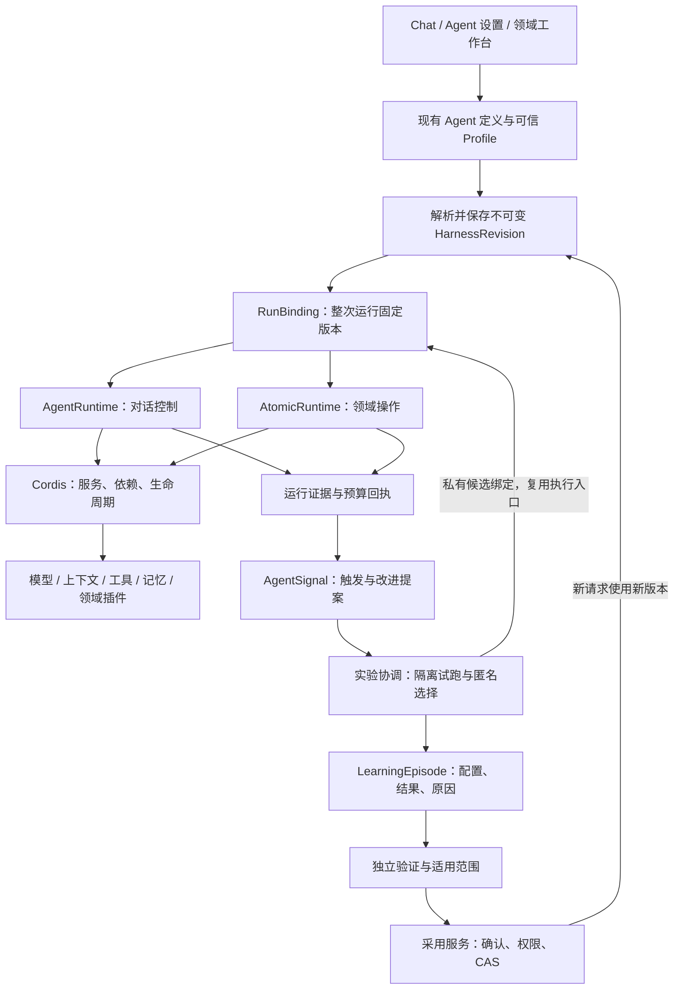

# 青舟核心架构演进：以 Cordis 组合能力，以实验验证改进

状态：设计与分阶段迁移目标；首轮实现及尚未完成的边界见[实施记录](harness-core-implementation.zh-CN.md)。核查日期：2026-10-21。

依据：当前 `codex/representative-page-trials` 工作树，包括尚未提交的代表页学习链路；本地 Harness² `1cfe254` 的源码。本文描述已读调用链与建议边界，不代表全仓审计或生产端到端验收。

## 1. 架构主张

**Cordis 管能力的装配、依赖与生命周期；Harness² 的思想用于管理配置如何经过实验成为更好的版本。两者通过“运行绑定的不可变配置版本”结合。**

保留两个各有职责的执行入口：`AgentRuntime` 管对话决策、步骤与用户介入；`AtomicRuntime` 管领域操作、权限、取消和能力组合。它们共享原生 Cordis 基础、版本契约与证据协议。学习模块也作为可信 Cordis 服务装配，复用上述执行入口，不另建一套求解器。

普通请求执行一次正常任务；学习是可关闭、有独立预算的流程。启用新技术时，替换实现同一服务契约的插件，生成候选配置版本，再经过相同的实验和采用流程。关闭学习不影响对话和领域功能。

## 2. 当前代码的真实起点

### 已有的核心能力

- **原生 Cordis 已进入 Agent 主循环。** [AgentRuntime](../../packages/agent-runtime/src/core/runtime.ts) 委托 [CordisAgentHost](../../packages/agent-runtime/src/core/cordis-host.ts) 执行 plan / execute；宿主通过真实 Context、服务和 waterfall 挂载行为。
- **已有确定性的装配配置。** [profile.ts](../../packages/cordis-runtime/src/profile.ts) 展开 bundle 和 patch；[loader.ts](../../packages/cordis-runtime/src/loader.ts) 在候选 Context 就绪后切换，并等待旧调用排空。Profile 只选择宿主注册的模块。
- **领域执行也使用同一原生基础。** [AtomicRuntime](../../src/server/runtime/atomic-runtime.ts) 和 [CordisAtomicHost](../../src/server/runtime/cordis-atomic-host.ts) 提供工具注册、scope、租约与操作生命周期。PPT、教学、站点的装配参见[现有说明](cordis-native-composition.md)。
- **AgentSignal 已有学习行为。** [orchestrator](../../src/server/services/agentSignal/orchestrator.ts) 组织反思、记忆和技能管理；[selfIteration](../../src/server/services/agentSignal/services/selfIteration/execute.ts) 运行受限 Agent。它不是一个待新增的空壳。
- **上下文构造有现成管线。** [ContextEngine](../../packages/context-engine/src/pipeline.ts) 提供 processors；服务端 [RuntimeExecutors](../../src/server/modules/AgentRuntime/RuntimeExecutors.ts) 使用 [Mecha ContextEngineering](../../src/server/modules/Mecha/ContextEngineering/index.ts)。应扩展现有管线的策略与版本，不另起上下文引擎。
- **PPT 已有更完整的实验闭环。** 配置快照、候选差分、真实 probe/render、匿名评价、用户选择、新版本、LearningEpisode 和独立验证位于[代表页实现](../../src/server/runtime/presentation/trial-learning.ts)及[说明](representative-page-trials.zh-CN.md)。它可以成为公共协议的首个领域消费者。

### 尚未连接起来的部分

1. 服务端 [aiAgent](../../src/server/services/aiAgent/index.ts) 已组装工具与技能，并把 `operationSkillSet` 等放入 operation state；[AgentRuntimeService](../../src/server/services/agentRuntime/AgentRuntimeService.ts) 会逐步重建运行器，但未把这些材料统一为可校验、可寻址的完整 harness 版本。
2. Chat 同时存在[客户端执行](../../src/store/chat/slices/aiChat/actions/streamingExecutor.ts)与服务端执行路径。只改服务端构造器，会留下客户端与续跑语义分叉。
3. [反思策略](../../src/server/services/agentSignal/services/selfIteration/tools/reflection.ts) 允许满足置信度、证据与修改范围条件的技能更新 `direct_apply`；[资源工具](../../src/server/services/agentSignal/services/selfIteration/tools/shared.ts) 已有 preflight、receipt 和 `replaceSkillContentCAS`。这些是可复用的写入基础，但不等于独立对照实验已经通过。
4. [OperationTraceRecorder](../../src/server/services/agentRuntime/OperationTraceRecorder.ts) 有上下文和步骤证据；默认 tracing 存储依环境配置启用。普通可选 trace、AgentSignal 通知不能直接充当必须持久化的实验账本。
5. [通用 serial 协调器](../../src/server/runtime/improvement/serial.ts) 已抽离一部分流程，但实际实验和学习语义仍主要由 PPT 承担。名称通用不等于核心 Chat 已接入。
6. `cordis-kernel` 仍提供被使用的 ToolRegistry、领域契约和兼容类型。`CordisAtomicHost` 委托原生生命周期，但这不意味着整个旧包已经可以删除。后续按真实引用逐项收敛，避免再造 Context / Fiber / DI。

因此，当前主要问题是**版本、证据和采用语义分散**。继续增加几个独立学习插件，会扩大这种分散。

## 3. 如何吸收 Harness²

本地参考位置：`/home/shiro/harness2/harness2/core/`。

- `recursion.py`：借鉴提出修改、真实试跑、组合改进的循环；在青舟使用受控配置差分和已有执行器。
- `library.py`：保留被采用的完整配置及适用条件、改动和证据。跨任务复用可追溯的版本，模型只读取受权限与大小限制的投影。
- `tree.py`：借鉴显式可编辑面。青舟按插件声明的 schema、路径和修改权限定义，而非机械搬运八个文件目录。
- `ledger.py`：借鉴预算守恒和可审计配方。青舟记录实际成本、预留额度、重试和取消，不把固定 `4k / 3k` 当成所有在线任务都必须消耗的额度。
- `selection.py`、`judge.py`：借鉴匿名比较和独立事后评估，区分执行失败、未知评价与质量差。
- `context.py`：借鉴训练材料、候选内容和评价信息的边界。候选材料保持数据身份，宿主策略掌握执行权限。

**需要纠正一个参考报告中的细节：** 本地 `selection_pool()` 明确排除 reference/base，只选择 `agg1..aggk` 或 `c1..ck`，没有独立的弃选入口。候选最终可能保留原配置，不等于原始基线作为单独选项参与最终选择。青舟应继续明确支持“保留原方案”，这是面向用户资产和在线服务的产品设计。

这些机制提升实验的可解释性与约束能力，不保证配置会持续变好。无法证明收益的候选可以一直不采用。

## 4. 目标结构：一个底座，执行与改进两个循环

图中的版本、实验和采用服务是拟新增契约。AgentSignal 保留其调度、恢复、去重与业务状态机；将服务接入 Cordis 不要求改写它的可靠调度器。Cordis 生命周期也不承担持久化队列的职责。

### 稳定核心与可替换策略

稳定核心包括身份与权限、配置校验、预算授权、取消、版本绑定、证据持久化和采用事务。它们在执行入口强制检查，不能被候选 patch 关闭。

可替换部分包括规划策略、上下文组织、记忆检索、工具指导、技能组合、提案算法、评价实现和领域能力。插件用类型明确的 Cordis service 契约提供这些能力，事件用于通知。预算预留、写入批准和 CAS 必须等待服务结果，不能仅靠发布一个事件获得授权。

同一进程内使用原生服务调用；只有远程 worker 或外部供应商需要传输适配。契约和业务实现保持分离，不为每个能力额外搭一层 HTTP 服务。

## 5. 最小公共模型

以下名称为拟议契约，落地时优先复用现有类型与存储，不要求一次新增所有包。

### HarnessRevision：一次可执行装配的不可变版本

现有业务 Agent 定义保留名称、角色、用户设置；`PluginProfile` 保留模块选择和装配补丁。二者解析后的可执行结果才成为 `HarnessRevision`，避免再出现第三种含义模糊的 Profile。

版本包含：schema 版本、账号/Agent 作用域、父版本、解析后的插件条目与实现版本、提示和技能完整内容的受控存储引用及摘要、上下文策略、模型绑定与参数、工具目录版本、能力限制，以及解析器版本。

引用必须指向不可变内容；只有 hash 或指向可变技能正文的 ID 不构成完整快照。凭证保存可解析的授权引用，不把 token、cookie 写进配置。完整材料按账号授权保存，访问、保留期和删除规则随材料执行，不能以“学习”名义永久保存所有聊天。

宿主权限策略单独版本化：候选不得放宽它。运行期间的权限撤销仍应立即生效，固定旧配置不能绕过新的拒绝策略。

### RunBinding：整次 operation 的版本绑定

创建 operation 时保存 `revisionId`、解析摘要、执行模式、预算授权和作用域；每一步、重试与恢复均沿用该绑定。AgentRuntimeService 重建 runtime 时读取固定版本，不能重新使用最新配置。新版本切换只影响新任务。

配置与运行材料分开：消息、检索命中、动态工具结果、实际模型路由与产物进入运行证据。模型别名可能变化，记录可获得的实际供应商版本；回放声明自己支持的级别：固定输入重跑、工具录制回放或隔离环境执行，不承诺外部世界和模型输出完全可复现。

客户端执行使用同一数据契约，仅取得允许下发的投影。客户端上报带有来源标记，不能独自证明一次实验符合服务器权限和预算，也不能直接激活全局版本。纯本地运行可保留本地证据，并明确其可信边界。

### SurfaceDefinition：由能力提供者声明可修改面

每个支持优化的插件声明 surface ID、schema 版本、可修改字段、大小和取值限制、适用任务、兼容条件及所需验证。第一批仅开放任务指导文字和少量上下文策略参数。

校验是完整的“基线版本 + 受限差分 → 新版本”，省略字段继承。补丁必须显式携带基准版本；拒绝未知路径、删除必需配置、放宽权限、替换任意代码路径或增加未注册模块。整个结果经过装配和依赖验证后才进入试跑。

代码和新架构由开发者作为可信插件接入；模型优化它们公开的配置。确需生成脚本时，应另设代码审查和执行隔离等级，不把配置编辑偷偷升级为代码部署。

### Experiment 与 LearningEpisode：执行事实和迁移经验

Experiment 保存预先确定的任务、基线、候选、模型设置、预算、评价规则版本和验证集引用。RunEvidence 记录每次尝试、消耗、取消、输出、失败类型和完整性。

LearningEpisode 关联完整配置、差分、预览/输出、匿名评价、用户决定、产物新版本、适用条件和理由。保留原方案、失败、成本超限和验证未通过同样是经验；缺失原因保持未知，不让模型编造。PPT 的领域详情继续由 PPT 保存，通过公共引用关联。

把三个维度分开：**实验执行状态、验证状态、采用决定**。本次产物被用户采用只证明这次选择；它可以同时处于待独立验证状态。`review_ready` 不等于默认生效，用户偏好也不等于客观质量胜出。

经验检索先按账号授权、能力版本、任务领域和适用条件过滤，再排序。复用历史配置时仍校验当前 schema 与宿主策略；不能把历史完整配置当成新的高优先级系统指令直接注入。

### Adoption：唯一的学习配置生效入口

复用已有 review、preflight、receipt 和 SkillManagement CAS，把“学习导致的共享行为变更”汇入同一个采用服务。先枚举反思直接写、review 应用、技能管理工具等入口；不能只封住其中一个工具。

人工主动编辑继续遵循用户授权，但同样形成版本并避免覆盖并发变更。用户事实记忆、可执行技能资产和实验经验是不同的数据，不需要把每条用户偏好都送进昂贵实验。

采用在服务端重新验证账号、目标、候选摘要、证据完整性和验证资格，以 `expectedActiveRevision` 做 CAS，原子记录决定并切换作用域内活动指针。用户确认必须绑定具体候选版本；过期确认返回冲突，不静默重基。

技能正文与活动指针分属不同存储时，不能用两个无协调写入假装原子：优先保存不可变新内容，事务中切指针并写决定；跨存储使用已有持久化工作机制补偿未完成步骤。可变正文兼容读取在迁移期间须明确版本规则。

回滚也产生带理由的指针切换和回执。正在运行的任务使用原绑定；已执行的发布、发送、付款等外部动作不会随配置回滚自动撤销。

## 6. 实验怎样复用执行链又不影响真实任务

实验协调器调用同一执行端口，指定 `probe` 模式和私有配置版本。执行端口由 AgentRuntime / AtomicRuntime 提供，提案策略不直接取得生产写端口。

每项操作由可信提供者声明效果类型，例如纯计算、读取、隔离写入、外部写入；执行器强制验证，缺少声明则不能用于自动 probe。读取也可能产生费用或隐私访问，仍需权限和预算。

候选 Context 只能隔离服务实例和生命周期，**不是进程沙箱或数据库事务**。试跑需要实际生效的资源隔离：文档/草稿使用私有存储分支，重放工具读取使用录制回执，外部写操作在没有专用测试环境时拒绝。插件初始化、定时器和 dispose 也可能产生副作用，试跑宿主只能装配通过隔离审查的模块。

第一轮 Chat 实验选择纯文本或只读检索任务，不复制生产对话的发送、设备控制与发布动作。正常用户请求不默认同时执行基线与候选。

预算由一个父账本管理。提案、基线、候选、评价、重试和学习记录生成都申请子额度；下游模型、工具及领域调用从父额度拆分，不重复扣费，也不能绕过父上限另起无限循环。费用无法精确预估时保守预留，回执补齐后结算；未知消耗不直接释放为零。

取消后拒绝新授权，传播到模型和工具，等待在途调用收尾并记录终态。不支持及时取消的供应商保留未结清消耗，不允许迟到结果覆盖已结束状态。多 worker 下，预留、租约和终态必须由持久化幂等机制保护；现有单机内存队列不能被描述为分布式预算。

## 7. 评价与经验反馈的边界

一次实验开始前固定任务集合、模型绑定、预算和比较方式。候选可以看到任务要求与可见 probe 行为；独立验证集、隐藏判分细则及其分数不进入本轮提案上下文。普通用户的公开验收要求应正常提供。

评价分三层：

1. 确定性门槛：任务完成、schema、权限、取消、预算和领域约束。失败即无采用资格。
2. 匿名比较：任务满足程度、事实依据、可用性及预先声明的成本/时延权衡。展示顺序种子化；保留原方案始终有效；模型评价记录理由和不确定性。
3. 独立验证：使用未参与提案的任务验证迁移效果，成本计入验证预算。未通过则保留原版本；查看验证结果后再次修改候选，需要新的未使用验证集。

第一批 Chat 固定样本至少覆盖无需工具的回答、必须检索才能回答的问题、信息不足时的澄清/弃答，以及工具不可用；另外用确定性测试检查取消、预算、恢复与权限。预算内样本不足时报告证据不足，不制造“显著提升”。同模型也可能随机波动，少量胜出只支持局部试用。

AgentSignal 原有的自评可以生成改进建议，不能同时冒充独立验证者。评价异常记录为 `unknown/failed`，与低质量结果分开；只读任务成功不能外推到有副作用的任务。

## 8. 后续新技术如何自然接入

**新的记忆或检索架构：** 实现现有上下文管线使用的检索服务契约，声明数据授权、索引版本、命中证据和成本。通过候选策略版本比较有无帮助、无关信息率与成本；用户事实库无需改成实验数据库。

**新的规划算法：** 在 Agent 的 plan 服务位置提供实现，保持 AgentRuntime 的步骤、用户介入、租约和执行类型约束。先用可重放任务验证，再开放新请求使用新版本。算法内部如有并行分支，也必须使用同一父预算和取消树。

**新的模型、工具协议或远程执行设施：** 在模型/工具/执行端口实现适配并申报能力，包含 streaming、cancel、effect isolation、usage receipt。缺失能力就拒绝需要该能力的实验；不会要求 Chat 或 PPT 到处增加供应商条件分支。

**新的业务领域：** 通过 Cordis 插件声明领域操作、产物、可编辑面、效果类型和领域评价器。领域定义自己的质量约束，公共层不认识 SVG、页码或站点路径。

每种接入都经过相同的契约符合性检查：schema 兼容、作用域隔离、取消、预算、幂等、证据和卸载排空。升级 schema 生成新版本并显式迁移，保留旧记录的可读性；不默默解释成新语义。

这样未来技术替换的是明确的能力位置；引入新的调度或存储设施也只替换相应提供者。当前阶段无需先新增微服务或消息平台来证明“可扩展”。

## 9. 代码归属与依赖方向

- `packages/cordis-foundation`：上游原生机制的唯一基础，保持薄。
- `packages/cordis-runtime`：可信装配、配置解析、generation 生命周期。可承载纯版本解析辅助代码，不依赖业务数据库或 PPT。
- `packages/agent-runtime`：通用对话运行与 Cordis 宿主，接收只读 RunBinding；不导入服务器实验服务。
- `packages/context-engine`：已有上下文管线，通过类型明确的策略参数扩展。
- `src/server/runtime/improvement`：先承接已验证的协调共性；增加与领域无关的契约时不反向导入 `presentation`。
- `src/server/services/agentSignal`：保留信号、反思、调度、review；通过契约请求实验和采用。
- `src/server/services/agentRuntime`：operation 的持久化绑定、执行端口与证据装配。
- 领域目录：保留任务定义、渲染、质量规则和特有经验字段；UI 负责解释证据与明确选择，不能自行授予采用权限。

只有 Chat 与 PPT 都证明需要的共享数据契约，才提取到独立公共包；不提前创建一整套空插件包。AgentSignal 的持久化调度可以作为 Cordis 服务的实现，稳定的调度状态机不因统一术语而重写。

## 10. 分步迁移与每一步的验收

### 第一小步：让核心对话能够回答“这次到底用了什么配置”

范围：定义最小版本/绑定契约，给服务端 operation 创建、逐步重建与恢复串起固定版本；客户端路径保存同形投影和来源标记。暂不增加模型调用，不自动改写提示或技能。

主要落点：`aiAgent/index.ts` 的材料组装；`AgentRuntimeService.ts` 的 state / metadata 保存与重建；`agentRuntime/types.ts`；客户端 `streamingExecutor.ts` 的初始化；现有 trace 的版本引用。两个 metadata 通道要一致，不能只修改 initial state 而遗漏 coordinator 的 operation metadata。

验收：相同材料得到相同摘要；技能正文变化产生新版本；材料对象后续被修改不影响已存快照；中途更新 Agent 后，旧 operation 续跑仍绑定旧版本，新 operation 使用新版本；跨账号不可读；凭证不进入快照；缺少旧版本时明确终止恢复，不能退回 latest；客户端与服务端投影可互相校验且不泄露私有材料。

迁移前存量 operation 没有完整快照时明确标记 `legacy/unverified`，仅沿用其已有状态继续，不反推并伪造完整版本，也不纳入实验有效样本。

旧存储或快照功能关闭时，普通任务维持已有兼容路径并标记未追踪；正式实验必须具备可持久化完整版本，缺失即拒绝开始。初期可作为旁路记录上线，验证稳定后再将版本解析成为正式执行输入。

### 第二小步：纯文本 Chat 的私有候选试跑

只开放一个已注册 surface；接入真实 AgentRuntime，固定小预算，明确基线与候选，以及保留原方案。加入禁止生产写入的执行策略。定向测试覆盖差分越界、取消、预算预留、迟到结果、候选失败与 baseline 胜出；真实模型样本另行记录，不用 mock 胜出证明实际改进。

### 第三小步：AgentSignal 提案和采用路径收敛

反思产出候选与依据，接入现有 review；把学习行为修改的直接写和审批写都接到采用服务。当前置信度门槛可以保留作提案筛选，不能代替实验资格。验证幂等、过期确认、并发 CAS、权限撤销，以及禁止绕过验证的所有已枚举写入口。用户主动编辑与用户事实记忆保持明确的独立策略。

### 第四小步：独立验证、有限作用域采用与回滚

在登记的未见任务上验证，按用户/Agent 作用域启用；观察错误率、任务成功、成本和延迟。预算与阈值预先声明，不能因为某轮分数不好临时改变。验证未完成保持候选状态；验证通过仍需满足采用政策。演练新旧运行并存、异常恢复与版本回退。

### 第五小步：PPT 迁入共同协议，再接第二类技术插件

让既有代表页实验和 LearningEpisode 实现公共版本/证据/采用契约，保留原 ID、原稿、选择与验证证据。通过字段兼容和新旧结果对照迁移，避免重写已完成的领域逻辑。

再选一个确有需求的新检索或规划实现，验证只增加插件、surface 和符合性测试即可接入；如果仍需改 Chat、PPT、AgentSignal 多处专用分支，应回到边界设计修正，而不是继续扩展通用配置袋。

## 11. 完成标准与本次交付边界

架构融合完成的标准是：Chat 和至少一个领域共享版本与证据协议；学习行为变化通过统一采用入口；新旧运行隔离；预算、取消与副作用约束在真实执行链生效；新技术通过稳定契约接入；关闭或回滚学习不会破坏正常功能。

设计稿形成时仅新增文档；后续实施进度和验证层级在[实施记录](harness-core-implementation.zh-CN.md)更新。文档检查不能替代运行、存储并发或浏览器验收；各步完成状态以实际调用链与回归证据为准。
