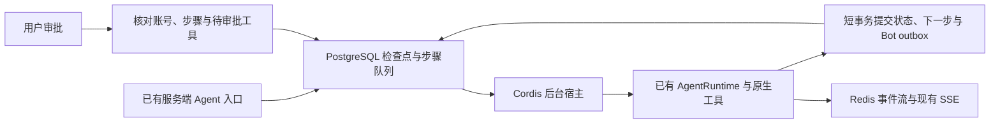
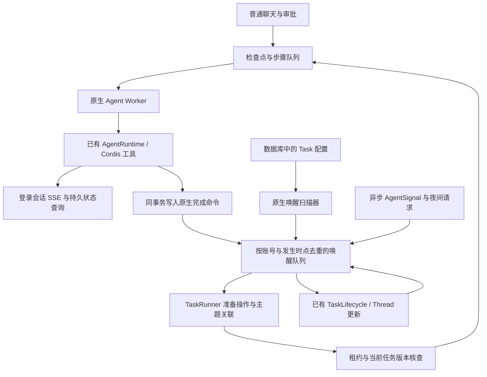

# 清舟原生能力装配与小型服务器改造

本轮直接改造清舟的原生插件和生产调用链。模型继续使用外部 API；4 核 4GB、8 核 8GB 是部署验收目标。资源实测、构建失败原因和验证范围见 [资源基线](./qingzhou-resource-baseline.md)。

## 四个开发边界

- **Operation**：一个有独立价值的动作。输入、输出、所属账号、取消与副作用由操作契约明确；可信调用上下文来自宿主。
- **Plugin**：一组共享领域规则或资源生命周期的操作。插件由真实 Cordis 挂载、替换、卸载；同一数据事务不必拆成多个插件。
- **Recipe**：围绕目标组合操作。目前 `skills.catalog` 提供配方目录，`skills.run` 接受具名步骤及 `$ref` 结果引用，`skills.autorun` 在受限目录中选择工具。目录里的步骤名称是配方说明，实际执行仍需完整输入；它们不是未经验证就能执行的任意代码。
- **Profile**：可信宿主选择 bundle 和按 ID 的 add/replace/remove。Profile 可以装配教育、创作、站点等场景；请求和模型不能修改宿主模块、策略或权限。

## 通用组合器

[`AtomicOperation.agent.contexts`](../../src/server/runtime/atomic-runtime.ts) 中的 `skills` 表示插件主动允许该操作参与组合。调用目录从当前实际挂载的插件生成，宿主 `policy` 只能收窄这个集合。通用层不再维护 PPT 名称白名单，不再导入 PPT 提示处理或具体模型实现。

`createSkillsPlugin(runtime, chatSource?, options?)` 的 `options` 接收场景配方、指导词和策略。`chatSource` 可以从本次 `AtomicInvocation.services` 解析账号模型，避免把用户凭据保存在全局站点宿主。PPT 的模板指导和生图请求编号规则位于 [`presentation/recipes.ts`](../../src/server/runtime/presentation/recipes.ts)。

组合步骤最多 16 个；自主组合最多 10 次模型决策、2 次工具失败，并遵守每个操作的 `maxCalls`。整个组合持有参与插件的租约，再核查目录与策略，避免验证和执行之间被热替换。请求取消会传播到每次模型和操作调用。成功写出的产物不会因后续失败自动撤销。

幂等结果缓存最多保留 64 个请求，运行中的请求不被驱逐；容量用尽时明确拒绝新增工作。诊断事件默认最多保留 256 个账号 / 会话范围，每个 200 条；历史淘汰不影响运行中的任务及实时事件。

## 独立教学插件

[`teaching`](../../src/server/runtime/teaching/atomic-plugin.ts) 可以在没有 PPT planner、模板库或渲染 worker 的宿主中挂载。它提供教案规划、修订、校验、公开教学阶段编译，以及账号所属教学记忆检索和组合。

教学输出保留教师目标、阶段和任务的语义；PPT 的教案转页、SVG 与导出检查仍属于演示文稿领域。既有 `presentation.lesson.*` 和教学记忆调用通过 `runtime.invoke()` 转发到教学插件。生产备课 UI 也经过同一插件，卸载后会明确不可用，不回退到绕过宿主的模型直调。

默认 PPT bundle 现在装配 `teaching + presentation + assets + skills`。教学数据仍使用原账号持久化实例；卸载插件不会删除用户记录。

## 原生站点组合

2026-10-11：生产站点宿主新增可信 `education` Profile。设置 `QINGZHOU_SITES_PROFILE=education` 后，首次访问按需装配 `sites + skills + teaching + content`；默认 `sites` Profile 保持两项基础能力。请求不能自行切换 Profile 或加载外部代码。

`lesson-to-article` 配方组合 `teaching.lesson.compile → content.lesson.markdown → sites.edit`，生成带 `draft: true` 的 Markdown。格式化只读取编译后的阶段标题和可见内容，不复制教师提示、隐藏答案或整个教案；发布仍由现有显式发布操作执行。可在前面增加 `teaching.lesson.plan`，模型从本次认证账号的调用上下文解析，不缓存首个账号的模型端口。当前已验证 HTTP 处理器、真实临时文件存储和模拟模型；尚未验证真实模型服务或新增前端配方入口。

站点存储的写入队列按账号隔离，同账号继续检查基准版本；新建时仅统计有效站点文件，避免加载所有正文及发布历史。列表读取逐个处理，降低并发读取和解析的瞬时分配；现有列表仍返回完整站点，不能将此项描述为已经实现轻量摘要分页。该文件存储及队列仍用于单进程部署，多副本需持久化事务支持。

[`createSitesRuntime`](../../src/server/runtime/sites/runtime.ts) 通过同一 Profile resolver 原生装配 `sites + skills`，可以选择可信额外模块。例如在宿主代码中加入教育能力：

```ts
const { runtime } = createSitesRuntime({
  store,
  plugins: { teaching: createTeachingPlugin() },
  profile: {
    bundles: ['sites'],
    patches: [{ op: 'add', entry: { id: 'teaching', use: 'teaching' } }],
  },
});
```

没有提供模型端口时，教学编译、修订检查等本地操作仍可使用；需要模型的教案规划不会出现在目录里。

`sites.edit` 是可组合的草稿编辑操作，只接受字符串内容，不提供删除语义。人工 `sites.change` 保留原有显式 `null` 删除协议；发布与回滚继续作为独立操作，不向自主组合开放。

原 `sites.agent.edit` 现在复用 `skills.autorun`，保持界面的请求和 `{ site, summary }` 响应。宿主在模型调用前检查账号、当前站点和批准的基准版本，全程持有站点租约，禁止模型跨站、删除、发布或自动重基。模型仅得到当前草稿；保存结果使用小型 `SiteEditReceipt`，不会把完整版本历史反复放入上下文。

HTTP 路由继续承担认证和传输。站点与教学组合直接调用原生操作；没有为这条组合链增加站点间 HTTP 适配器。已有文档公开读取协议保持兼容。**Fumadocs 的独立身份、审核与 outbox 仍未全部迁入原生共享领域层**，本轮原生组合测试不能替代那部分迁移和真实跨站验收。

## 资源与启动

`QINGZHOU_SERVER_PROFILE` 选择 `4c4g` 或 `8c8g`，默认 `4c4g`：

- 4c4g：图片处理并发 1、等待队列 16；PPT 生成并发 1、等待队列 4。
- 8c8g：图片处理并发 2、等待队列 32；PPT 生成仍从并发 1 起步、等待队列 8。提高重任务并发应先测实际峰值。

PPT 账号端口与直接生成接口共享同一 composition 的限额。等待时任务保持 `queued`；取消移除等待项，超额工作返回可重试的容量错误。这里是单机宿主的限额，多个进程 / 副本不会自动共享内存队列。

素材插件首次处理图片时才加载 Sharp；仅访问能力目录不会加载它的原生图像处理依赖。共享产物接口移到 [`artifacts/contracts.ts`](../../src/server/runtime/artifacts/contracts.ts)，PPT 旧类型导出保持兼容。部分图片生成实现及产物 URI 仍沿用 PPT 领域实现，尚不代表所有素材实现都已迁出。

Next 默认关闭 `preloadEntriesOnStart`。这减少启动时的路由预加载；已经访问的模块仍受 Node 缓存，不能把插件卸载等同于模块代码从进程中消失。

远端市场 sitemap 默认关闭，避免个人服务器构建时抓取整个上游市场并生成数千个分页。本地页面索引、robots 与 sitemap index 保留。确实运营完整市场 SEO 时，在构建环境显式设置 `QINGZHOU_MARKET_SITEMAPS=1`，并重新构建；这不是运行时开启后就会补齐全部静态分页的功能。

预构建完成后可运行：

```bash
bun run start:compact 4c4g
# 或
bun run start:compact 8c8g
```

启动器复用 Next 的生产环境文件加载，支持普通 Next 产物和 standalone。它检查构建清单，拒绝仅留下 BUILD_ID 的失败构建；standalone 改变工作目录时，两个内容数据根仍固定在项目根目录或用户显式指定的位置。默认 Node old-space 上限分别为 1024 / 2048 MiB，用户显式 `NODE_OPTIONS` 堆配置优先。

2026-10-11：Linux 上检测到 Node 的 `process.execve` 时，启动器直接替换为服务器进程，保留单个服务 PID，释放启动器的堆；其他平台或不支持的 Node 版本继续使用子进程方式。此 Node API 从 22.15 起提供，当前仍标为实验性（见 [Node 官方说明](https://nodejs.org/docs/latest-v22.x/api/process.html#processexecvefile-args-env)）；需要兼容模式时设置 `QINGZHOU_SPAWN_SERVER=1`。PID、持久化目录、堆预算与兼容模式经过回归验证，真实 cgroup 测试检查了停止后服务和端口释放。

构建可运行 `bun run build:compact`，默认采用 `8c8g` 构建预设，完整执行 SPA 与 Webpack Next 构建。它是构建机的内存优化选项，实际占用和更长的构建耗时见资源基线；4GB 服务器采用预构建产物。构建预设与上述生产启动预设分开。

**old-space 不是 RSS 或整机上限。** 原生图像缓冲、导出子进程、数据库和独立子站还需要容器 /cgroup 预算。生产测量记录中的受限公开 Web 测试也不能替代整套数据库、登录、真实模型与 PPT 导出验收。当前没有实施 Go 重写；先依据同工况 CPU 和内存剖析定位需要独立 worker 的热点。

## 本轮验证方式

2026-10-10 本轮统一回归：23 个 Vitest 文件、220 项测试通过；启动器在宿主机的 2 项回归、采样工具的 8 项核算测试通过。`bun run type-check`、改动源文件 ESLint 和 `git diff --check` 通过。启动器测试在沙箱内曾因 Node 子进程标准输出被丢弃失败，最小复现确认后在宿主机通过；未把沙箱失败计为通过。

- 原生插件：独立教学调用、卸载后拒绝、PPT 兼容操作、跨领域组合、策略收窄和账号隔离。
- 站点：真实临时文件存储、草稿读写、版本冲突、原生教学到文章组合、模型与公开发布边界。
- 资源：并发 / 队列上限、等待取消、两个生成入口共用容量、容量失败后重试。
- 构建：默认 sitemap 不加载远端发现服务，显式启用保留原分页逻辑。
- 启动器：失败产物检测、standalone 持久化目录与用户相对路径配置。
- 性能：宿主进程 /cgroup 采样、独立 Node 核心微基准、隔离生产构建及受限 Web 启动。具体结果与限制写在资源基线中。

这批改动不包含前端插件插槽自动装卸、统一运维控制台或多主机调度。现有 Cordis 状态机、租约和 Profile loader 继续复用；后续应将这些真实宿主状态接入管理界面。

## 2026-11-10：内置插件目录与延迟装配增量

本增量继续使用原生 Cordis Context/Fiber。`ProfileModule` 支持可信的 `load()` 工厂及可选的 `{ id, version, requires }` 描述。`describeProfile()` 只读取选中项的描述与配置，检查描述身份、缺失依赖和循环依赖，不执行工厂。`LoadedProfile` 在装配选中的项时调用工厂，仍由原生服务注入决定激活。加载失败时释放候选 Context；替换失败保留旧代，已有调用继续由原来的 drain/dispose 契约保护。工厂不能由配置中的路径、请求参数或模型输出指定。

音乐、PPT 和站点的 Atomic Profile 现在接受可信的同步或异步工厂。未选中的工厂不会执行，排队等待的工厂在宿主已经关闭时不会启动。`ready()` 可观察整个选中插件组的初始化；音乐与站点的生产缓存不会永久保留失败的初始化。PPT 的教学兼容操作仍使用同一份教学描述并通过原生操作转发，未新增执行内核。

`src/config/builtinPlugins.ts` 保存这三个试点的公开 ID、版本和路由归属，不导入业务实现。服务器通过 `QINGZHOU_PLUGINS` 选择可信的部署清单，并经已有 server config 下发给 SPA：

```dotenv
# 未设置：保持 music、presentation、sites 全部启用
QINGZHOU_PLUGINS=music,presentation,sites
# 示例：仅启用音乐和站点
# QINGZHOU_PLUGINS=music,sites
# 显式空值：停用三个试点
# QINGZHOU_PLUGINS=
```

修改部署清单后需要重启服务器并刷新客户端。未知 ID 会使调用返回配置错误，不会被解释为代码路径。Web、Electron 和移动端已有的对应路由在配置确定前保持未激活；禁用时不渲染 lazy 子树，直接链接返回首页。侧栏和命令菜单同步过滤，Electron 的三个试点也改为动态导入。音乐离开页面后继续播放；清单撤销音乐时，释放已经激活或迟到的音频会话，并保留聊天子树。

私有站点、公开站点、音乐账号、封面、音频流及 PPT 路由都检查同一清单。已存在的认证与账号边界保留，领域服务在检查通过后创建。PPT 默认 composition 从路由导入时装配改为首次请求装配；直接的生产运行环境入口也校验启用状态。聊天系统能力桥在 PPT 停用时移除对应目录项并拒绝调用，包括不依赖远端 PPT 提供者的绘图操作。

验证覆盖真实 Cordis 激活及释放、异步提供者依赖、未选中工厂、加载失败保留旧代、关闭期间的迟到加载、禁用路由不下载页面、配置引导、音频释放、HTTP 与工具入口拒绝，以及既有 PPT 恢复和跨账号调用回归。

范围：这是三个内置领域的部署级选择和选中插件组的延迟装配。尚未提供用户界面的安装/停用管理、账号级启用策略、服务器空闲自动回收或跨进程热卸载；运行中的后台任务也未因此改为新的持久工作流。JavaScript 模块缓存不随资源释放而卸载。完整构建体积、冷启动和常驻内存的节省比例仍需同工况测量。下一增量继续接入已有 AgentSignal、审批与任务回执，完成关闭网页和重启后的恢复闭环。

本轮定向验证合计 31 个文件、265 项测试通过；全仓 `tsgo --noEmit`、改动 TypeScript 文件 ESLint 与 `git diff --check` 通过。配置路由中一项旧测试仍假定 DeepSeek 为默认提供者，已按既有生产配置改为验证 Qingzhou/Nexus，未修改生产提供者默认值。本地运行中的公开配置接口返回 200，并包含三个试点 ID。未执行本轮完整生产构建、真实浏览器端到端验收或线上部署。

## 2026-11-10：原生后台执行与审批恢复增量

本增量为已有服务端 Agent 操作增加 `AGENT_RUNTIME_MODE=native`。继续使用 `AgentRuntimeService → AgentRuntime → CordisAgentHost`，没有新增推理循环。可信 Profile 装配 `native-agent-worker@1.0.0`；Context effect 启动监督器，释放宿主时停止认领、传播取消并等待当前调用退出。执行器模块、Redis 和数据库结构在开始认领前检查，访问页面不会启动这个 worker。



### 持久化与恢复规则

- 迁移 `0114_native_agent_runtime.sql` 增加 `agent_runtime_checkpoints` 和 `agent_runtime_jobs`。前者保存完整运行状态、基础元数据和最多 200 条步骤摘要；等待审批不再受两小时缓存期限影响。账号删除级联删除这两类记录；尚未提供完成任务的保留期清理策略。
- 同一账号/操作/步骤只有一个任务身份，已接受的上下文和载荷以规范化摘要绑定。重复提交返回原身份；更换工具或参数的提交被拒绝。延时和传输重试提示不改变业务身份。
- 步骤结果、下一步任务和内置 Bot 回调 outbox 在同一 SQL 事务提交。错误退出使用的状态提交路径也写入回调。模型和网络调用不在事务中执行。任一写入失败会整体回滚；自定义外部 webhook 仍走原来的传输路径，不在这个原子保证内。
- Worker 先认领，再记录派发，再进入已有执行器。SQL 用数据库时钟和所有者 token 校验步骤与任务租约；本地超时从认领请求发出前开始计算，迟到响应不能延长所有权。失去所有权的执行器会收到取消信号，不能提交状态或安排下一步。
- 重启后，过期但未派发的认领可再次执行；已经提交检查点的步骤只补齐确认。已派发、却无法从检查点证明结果的任务进入 `unknown`，操作暂停并设置 `canResume: false`，不自动重发模型请求或外部动作。这是结果核对边界，不是对外部服务“恰好一次”的保证。
- 完成、等待审批和中断通知在 Redis 确认发布后才标记通知完成；重启能补发已提交但未通知的终态，通知允许重复。取消先落库并撤销任务/步骤所有权。原生模式取消后的旧任务不直接恢复；未知结果的人工核对界面和显式重试命令仍待接入。

### 审批与账号边界

沿用现有工具干预策略和审批卡片。原生模式接受审批前核对操作所属账号、当前 `waiting_for_human` 状态、步骤编号以及持久化工具消息。执行时再次核对。批准只引用已经保存的待调用工具；不能借批准载荷替换 API 名称或参数。拒绝和问答同样绑定账号及待处理消息。状态读取、启动、中断和同步执行也检查所属账号；外账号步骤在取得租约前就被拒绝。原生 SSE 入口先经过现有登录认证，再核对检查点所属账号，之后才读取事件流。

这不等于新增了一套覆盖全部工具的 `allow | ask | deny` 管理界面，也没有迁移已有审批记录到新的独立审批表。原生 worker 的维护回合复用现有 Bot inbox/outbox 的恢复和投递服务；本轮没有向真实消息平台发送测试消息。

原生模式在创建操作前拒绝只有内存函数、没有持久描述的 hook，避免重启后静默丢失后续动作。现有仅使用函数回调的子 Agent Thread 更新需要迁为可信命令后才能接入原生队列；Bot 已有序列化 webhook 描述可沿用。这个限制不会改变默认 local 模式。

### 启用与部署

默认执行模式保持原样。先停止接收旧模式的新任务、排空或核对尚未完成的本地/Redis/QStash 操作，再运行既有数据库迁移命令 `pnpm db:migrate`，确认包含 0114。旧缓存状态不会自动复制到新检查点。Web 与 worker 使用同一数据库、Redis、密钥及应用环境配置：

```dotenv
AGENT_RUNTIME_MODE=native
REDIS_URL=redis://localhost:6379
# 方案 A：在常驻 Next 服务启动时挂载
QINGZHOU_AGENT_WORKER=1
```

方案 B 不设置 `QINGZHOU_AGENT_WORKER`，用进程管理器单独运行 `pnpm agent:worker`。独立入口需要完整工作区、已安装的 tsx 及支持 `registerHooks` 的 Node；当前加载检查在 Node 26 执行。它尚未打包进 Next standalone 镜像。`pnpm agent:worker --check` 仅验证执行器模块能加载，不认领任务，也不替代数据库/Redis 的运行就绪检查。独立进程接收 SIGTERM/SIGINT 后释放宿主。多个 worker 使用 SQL 认领与租约协调；真实 PostgreSQL 多进程并发还需要单独验收。

本轮没有修改当前预览环境的执行模式，也没有对现有业务数据库运行迁移。不要在 Vercel 请求进程中嵌入常驻 worker；Web 服务可以提交持久任务，但执行宿主应由常驻服务器管理。

### 已完成范围与后续顺序

已接通的是**已有服务端 Agent 操作**的原生持久执行：任务一旦成功入队，其生命周期不再依赖网页标签。普通 Web 聊天的 `selectRuntimeType()` 默认仍选择浏览器执行器；本轮没有改变这个用户入口。AgentSignal 的 Workflow 触发，以及 Cron/Heartbeat 的本地或 QStash 调度也仍沿用原实现，不能把这个增量称为全部主动唤醒已经迁移。

下一步先将前台需要后台运行的任务交给同一服务端入口，接入当前状态查询/重新订阅与人工结果核对；然后将 AgentSignal、Cron 和 Webhook 的唤醒意图逐条迁入原生持久调度。之后再接 Computer 的会话租约/接管和 Spaces 的版本写入。学习采用仍复用已有 Harness 版本与实验约束，后台常驻不会自动授予新写入权限。

验证覆盖真实迁移的 PGlite 事务、回调回滚、持久审批状态、重复载荷冲突、租约失效、取消及通知重试。额外用磁盘 PGlite 在三个时点 SIGKILL 子进程，再启动新的 Node/Cordis 宿主：未派发、派发后未提交、提交后未确认；测试中的外部动作均未重复。这里使用受控执行器和测试回执，不代表真实模型、浏览器或平台 API 已通过崩溃恢复验收。

本增量最终定向回归共 17 个文件、330 项测试通过。全仓 `tsgo --noEmit`、改动源文件 ESLint 和 `git diff --check` 通过。独立入口使用临时测试密钥及不可连接的测试数据库地址通过 `--check` 模块加载检查，没有派发任务。未执行完整生产构建、真实账号浏览器验收或线上切换。

## 2026-11-10：普通聊天后台化与持久唤醒

继续采用 `AGENT_RUNTIME_MODE=native`。公开配置新增 `agentRuntimeMode: native`，普通 LLM 聊天自动使用已有服务端 `execAgent` 入口，不依赖 Gateway URL 或实验开关。前端继续复用已有远程聊天的消息创建、主题切换、流式渲染和停止动作；新增应用内 SSE 连接，使用当前登录会话认证。旧模式保持原入口，异构 CLI Agent 继续采用各自的运行器和标记过的传输方式。

### 聊天与重连

- 创建成功的操作由 SQL 队列和原生后台宿主执行；关闭页面只断开观察连接。显式停止通过已有账号认证接口中断操作。启动请求期间的停止保留入队响应，取得服务器操作 ID 后再发送停止，避免丢失取消所需的 ID。
- 连接前和连接中读取持久状态，事件断线后按 Redis ID 续接。即使事件已经超过两小时保留期，完成、错误、暂停审批等状态仍能从检查点恢复，不会仅因收不到旧事件而一直等待。流式连接没有被改造成第二个执行器。
- 批准、拒绝、问答、跳过和取消交互继续原来的操作。服务器从账号所属主题查找原生操作，再核对待审批调用、步骤、线程和工具消息。接受了审批、但 worker 尚未处理时，状态查询会报告 `pendingIntervention`；旧的暂停事件不会结束这次续接。问答回复不先写入“已批准”的乐观状态再启动浏览器循环。
- 主题的运行指针在检查点锁内绑定；终态只清除仍指向本操作的指针，等待审批时保留它。前端原生连接不再无条件清除服务器指针或覆盖其状态。已完成操作不会被迟到的绑定请求重新标成运行中。
- 普通聊天沿用用户已有的工具审批设置。需要 Electron 本地进程或 stdio MCP 的工具不会经原生 SSE 派发到一个不存在的浏览器执行端；已有的服务器工具和经授权设备网关执行的能力继续使用各自的边界。独立 Computer 的容器、浏览器与人工接管仍属于后续增量。

### 唤醒与完成回调

迁移 `0115_native_agent_wake.sql` 增加 `agent_wake_jobs`。`native-agent-worker@1.1.0` 显式依赖同一 Profile 中的 `native-wake-worker@1.0.0`。两个 Cordis effect 分别处理 Agent 步骤和唤醒命令，共用数据库和事件服务；任务回调不通过自调用 HTTP 绕行，也不要求配置 QStash token。



扫描器以最多 100 条任务为一页，将游标和扫描窗口保存在持久任务中；完成一轮后约 15 秒再扫描。心跳按任务配置、控制代数和上次心跳时间去重。Cron 支持五字段、列表、范围、步长、英文月份/星期、IANA 时区，以及标准的月日/星期匹配语义。重启时依据已保存窗口合并最近 24 小时内错过的时点，每个任务只补最近一次；首次启用从当前窗口开始，不导入旧 QStash 历史。

夜间扫描按已有的用户资格、当地 2–4 点窗口和活跃 Agent 策略执行；每页最多 100 个用户、每用户最多 20 个目标，一轮结束后按小时再检查。异步 AgentSignal 入口改为持久原生命令，既有内联反馈、权限与学习预算规则继续由原实现负责。重复请求的传输时间不改变事件身份，内容不同的同身份请求会被拒绝。

每次真正执行前都重新读取所属账号的任务，检查模式、版本、暂停、终止、人工待处理和执行次数上限。TaskRunner 先准备操作并写好主题关联，再以唤醒租约和当前任务版本为条件，原子提交第一步。崩溃后能识别已经准备的操作，沿用原输入、修复必要关联并安排首步，不重复创建主题。不能证明结果的已派发命令会保留 `unknown`，暂停相关任务；不会自动重发其外部动作。

原生 Task/Thread 完成命令与步骤状态在同一事务入队。Task 继续使用既有摘要、review、brief 和心跳策略；Thread 进度与结果使用可重做的账号范围数据库命令。旧的心跳、Cron 执行和 Task 完成 HTTP 回调在 native 模式只确认由原生宿主管理，避免两条执行链同时工作。自定义外部 webhook 的原有传输策略保持独立。

用户暂停、取消、重新开始时更新控制代数，撤销旧唤醒，包括旧的未知命令；重新开始会产生新的发生身份，不重放旧命令。完成处理中检查控制代数，状态写入在短事务里重新核对，避免迟到的完成覆盖用户暂停。Task context 的合并也采用账号范围行锁，保留并发更新的控制信息。摘要与 review 的模型请求仍在事务外；已经发出的外部请求无法由本地取消撤回。

### 启用与验证范围

先排空或核对旧模式操作，运行 `pnpm db:migrate` 至 0115。Web 与 worker 使用相同的数据库、Redis、密钥和 `AGENT_RUNTIME_MODE=native`，再选择 `QINGZHOU_AGENT_WORKER=1` 的常驻 Next 宿主，或由进程管理器运行 `pnpm agent:worker`。刷新客户端以取得新配置。`--check` 现在也预载唤醒处理器，只核对模块加载，不执行聊天、定时任务或模型请求。

初始代码交付时，预览未被切换到 native，也没有对已有业务数据库运行迁移。自动化测试使用 PGlite、受控模型边界和替代事件端口；没有调用真实模型或向真实消息渠道投递。验证涵盖普通聊天审批保留原操作、过期事件恢复、断线续接、启动期间停止、定时去重、暂停竞争、首步入队失败恢复，以及真实 TaskLifecycle 到下一轮心跳的闭环。另以磁盘数据库和全新 Node/Cordis 进程验证七种强制终止时点，受控外部动作没有重复。

本轮定向回归：根配置 37 个测试文件、619 项测试通过；数据库包任务模型另有 1 个文件、67 项测试通过，合计 686 项。Cordis 基础类型构建、全仓 `tsgo --noEmit`、相关文件 ESLint 和独立 worker 的无派发预载检查通过。Node 26 下测试使用 `--no-experimental-webstorage`，让 happy-dom 提供浏览器存储；数据库测试显式使用隔离的 PGlite。

本轮没有进行真实账号浏览器端到端、生产 PostgreSQL 多进程、完整生产构建或部署验收；实际资源和定时精度也未据此作量化承诺。完整保留期清理、后台任务运维界面、Computer 与 Spaces 仍按后续顺序推进。

### 同日本地启用与实际模型验证

按用户后续授权，已备份 `.data/local-preview/postgres` 与本地环境配置，迁移至 0115，并在 `.env.development.local` 启用 `AGENT_RUNTIME_MODE=native`。Web 继续监听 3010，独立 worker 使用相同环境和 Redis；`QINGZHOU_AGENT_WORKER=0` 避免 Web 重复挂载。此本地数据库是 PGlite Socket 的 PostgreSQL 协议服务，不代表生产 PostgreSQL 多进程验收。

- 普通聊天使用页面正常发送入口和已配置的真实模型。10:40:55.865（上海时间）收到入队确认后关闭整个测试浏览器；服务端 10:41:04.578 完成检查点，回复中包含结束标记。重新打开主题后实际看到了完整回复。
- 新建单次验证任务 T-1，配置 `* * * * *`、`Asia/Shanghai`、`maxExecutions=1`。10:41:00 时点被扫描器发现，约 10:41:02 启动，返回“定时唤醒验证完成。”；10:41:11 完成生命周期回调，任务状态为 completed，只有一个运行主题，后续分钟未再次运行。验证过程中没有直接调用 tick 或修改发生时点。
- 独立 worker 实测暴露并修正了开发环境加载和冷启动模块初始化顺序：开发模式加载 `.env.development.local`，共享执行器和唤醒处理器在轮询 effect 启动前预载；`--check` 使用同一预载路径。
- 初次启动切换曾中止一条测试聊天，已单独标识并归档，没有把它算作续跑成功，也没有自动重放其未知步骤。辅助 AgentSignal 事件仍有独立失败并保留为 unknown；本节仅确认普通聊天、Cron 唤醒及其完成回调，未将自演进链路标为通过。

本地证据保存在 `.data/local-preview/native-chat-proof.json`、`native-schedule-proof.json`、`native-activation-report.json`，页面截图为 `native-chat-result.png` 与 `native-schedule-result.png`。这些文件留在忽略目录内；账号、Cookie 与密钥不写入本文。

### 同日辅助自演进修复与验收

四条 `agent.user.message` 事件最初在满意度分类阶段失败。分类器默认使用 `nexus / gpt-5.4-mini`，当前接口实际返回 `ModelNotFound`；普通聊天配置的 `nexus / deepseek-v4.1-flash` 可正常调用。修复后，分析、技能决策和维护、即时反思、意图执行、夜间复盘都从事件所属账号的 Agent 读取成对的 model/provider；无 Agent 的用户级来源优先读取用户的 topic 模型，再读取所属 inbox。找不到配置或 Agent 不属于账号时明确失败，不静默改用内置 mini 模型。显式策略依赖覆盖继续生效。

完整反思的实测还暴露了两处缺口：

- Nexus 是标准 OpenAI-compatible SDK 传输，但尚未进入单次派发白名单，预算反思在创建模型运行时就被拒绝。审查其没有额外 chat 重试分支后，加入受审计传输范围；针对可重试的 503 响应，真实 Nexus SDK 配合替代 fetch 的测试证明 `maxRetries=0` 且只发出一次请求。未放开其它未审计传输。
- 旧的预算反思硬限 512 输出 token，真实模型一次消耗了全部 512（包括 378 个推理 token），没有产出工具调用。只读对照在 2048 上限内正常产生证据读取与 source 读取工具调用。现在反思输出上限为 2048，输入仍限 128 KiB；预留 token 额度同步为 134144，单次费用上限和调用次数上限不变。明确的截断结束原因，或缺少结束原因且耗尽输出上限，都会阻止后续工具执行。运行状态未达到 done 也不会被标记为成功；预算执行器向后台传播 failed，避免调用方将失败投影成完成的 review。

旧事件恢复前保存了原始 SQL 记录，逐一检查所属主题的写入回执为空、入口去重标记已过期，并确认失败发生在首个只读分类调用。仅恢复用户指定的四条事件，没有放开未知派发的一般自动重试。四条均由实际 worker 再次执行到 done，`success=true`、`deduped=false`，各产出一个分类信号。完成回执现在保留工作流摘要，能够区分真实执行与去重跳过。

隔离助手的实际后台验收通过：普通聊天生成完整行为基线后，将一条反思请求送入正常持久队列；worker 独立完成 3 次受预算约束的模型调用，读取主题级证据和冻结规则，记录 1 条待确认的规则候选、1 条 completed review 回执及本次来源对应的学习 observation。候选保留原规则；Agent 数据库中的原始规则和 active revision 均未改变。重复提交同一来源仍指向原队列任务，attempts 保持 1，候选仍为 1 条。它是待确认候选，并未经过独立评估或发布。

截至验收，四条原失败事件全部成功，`agent-signal` 的 unknown 数量为 0。诊断过程中暴露的两条隔离测试失败保留了备份并标为 superseded/cancelled，没有作为成功样本或重新执行不明写入。证据保存在 `.data/local-preview/evolution-diagnosis.log`、`evolution-recovery-audit.json`、`evolution-model-probe.json`、`evolution-e2e-proof.json` 和 `evolution-verification-report.json`。本地仍使用 PGlite Socket 与真实已配置模型；没有等待跨日夜间窗口或代替用户批准发布。

修复后定向回归 18 个文件、188 项测试通过；全仓类型检查、相关文件 ESLint、worker 冷启动预载检查通过。隔离助手在验收后关闭了 selfIteration，避免后续夜间扫描继续使用测试样本；日常助手配置保持原状，worker 继续运行。

## 2026-11-13：后台活动入口与后续迁移顺序

用户随后要求暂停所有项目程序。本地 Web、独立 worker、渠道进程、数据库、Redis 和预览已停止，相关 launchd 保活任务已卸载，数据与启动配置保留。本阶段继续修改代码和执行隔离测试，未恢复这些服务。

### 已交付：后台执行的可见性

任务页工具栏增加“后台活动”入口，仅在 native 部署且账号登录后显示。面板按需导入，打开后每 5 秒刷新，关闭即卸载；查询缓存包含账号标识，切换账号会卸载旧面板。筛选覆盖全部、执行中、等待审批、需要关注和已结束，显示聊天检查点、心跳、定时唤醒、自演进，以及结果未知的内部回执。已成功的内部回执不加入列表，减少重复信息。

`backgroundActivity.list` 是受认证、账号隔离的只读投影，直接查询现有 PostgreSQL 持久表，不初始化 worker 或模型运行时。每页默认 25 条、上限 50 条；两种来源按创建时间、来源和 ID 合并，游标保留 PostgreSQL 的微秒精度和 C 排序。标题、助手、主题、子任务和任务关联分别核对所属账号；不返回检查点全文、聊天消息、工具参数、回执正文、密钥或原始异常。

活动可跳回原对话、定位子任务，或打开既有任务。等待审批沿用原对话内的审批卡片；已接收但尚未执行的人工决定显示为排队中。停止聊天沿用现有授权中断接口，子任务同时传入所属 threadId，只有服务端确认成功并刷新持久状态后才显示已停止。`unknown` 单独显示并提示核对结果，不提供自动重放按钮。列表反映保存的工作状态，不据此声称 worker 在线。

本阶段不新增表或迁移，不改变执行和审批语义。隔离数据库测试覆盖所属账号及关联隔离、状态投影、微秒分页、唤醒来源和子任务上下文；接口测试覆盖认证、参数边界和部署模式；界面测试覆盖延迟查询、关闭停止轮询、分页筛选、账号切换和停止失败。真实浏览器视觉验收及真实 worker 联调留待用户恢复本地服务后执行。

本轮定向回归 8 个文件、51 项测试通过；全仓 `tsgo --noEmit`、相关文件 ESLint、静态样式 Stylelint、Prettier 和 `git diff --check` 通过。测试显式使用 `TEST_SERVER_DB=0` 的隔离 PGlite，没有启动本地数据库、Web 或常驻 worker，也没有调用真实模型。

### 继续推进的依赖顺序

1. **执行运维补齐**：为结果未知的操作增加带证据和审计记录的人工核对流程；补充 worker 心跳、队列延迟、终态保留期与清理。核对与重跑必须是不同操作，不能把未知派发直接归入一般重试。
2. **原生 Computer 能力插件**：在 Cordis 注册 Computer provider、能力声明和按需加载器；先实现每个助手隔离的会话、持久化存储、租约、命令回执和控制权状态，再接浏览器画面及人工接管。Web 页面关闭不影响电脑租约；接管时暂停 Agent 输入，交回时明确恢复。外部沙盒服务通过 provider 适配，凭据不进入前端或检查点。
3. **Spaces 文档插件**：将产物接入项目自己的文档、版本和权限存储；写入带预期版本号，冲突可见，执行回执保留来源。先完成单文档读写与版本冲突，再接协同编辑，避免用聊天消息模拟长期工作区。
4. **统一能力治理**：把工具、定时触发、Computer、Spaces、记忆和展示入口收敛到同一套插件声明、账号授权及审计机制。内核保留任务状态机、持久存储、租约和审批边界；音乐、PPT 等业务继续按启用配置延迟加载。能力插件失败不应使核心聊天和运维入口一起不可用。

以上顺序延续已有 native 内核，而非新增第二套 Harness。Computer 与 Spaces 尚未实现，不应因为已有 MCP 或文档组件就标为完成。

## 2026-11-14：异常人工核对与 worker 监控

本轮继续保持本地服务停止。新增迁移 `0116_agent_activity_operations` 仅写入迁移文件，在隔离的测试数据库中验证，未应用到 `.data/local-preview` 数据库；没有启动 Web、Redis、数据库、真实 worker 或预览浏览器。

### 异常核对

后台活动为 `unknown` / `failed` 记录提供人工核对入口。用户明确选择“确认已生效”“确认未生效”或“结束跟进”，填写 10–2000 字核对依据后，结论写入 `agent_activity_reviews`。原始检查点、隔离任务、执行次数、暂停状态和消息均保持原样；核对不授权重放，也不触发恢复或成功回执。

结论按账号、来源类型、活动 ID 和异常版本唯一保存。版本包含检查点更新时间和子步骤的执行状态、次数等字段；人工核对先锁检查点、再锁子步骤，与执行器保持相同锁顺序。旧页面对应的版本发生变化时拒绝写入，重复提交相同结论返回原记录，竞争的不同结论只保留先提交的一条。通知送达标记不构成新异常，不会使已保存的核对失效。

“需要关注”只显示当前版本尚未核对的异常，“已核对”单独展示当前人工结论。核对不会把原始 `unknown` 改成 `completed`。同一活动出现新异常时重新进入需要关注，旧结论仍留在历史中；执行后来改变或恢复后，也可只读查看最近 20 条历史。证据和历史查询均限制为当前账号，前端缓存继续按账号隔离。

### worker 与队列监控

两个 Cordis native worker 在生命周期中接入同一个监控 supervisor。每次启动生成独立实例 ID，写入 `agent_worker_heartbeats`；每 5 秒更新心跳，轮询开始、成功和失败分别保存时间，并记录连续轮询失败次数。心跳与实际执行分开，长模型调用不会因未完成整轮轮询而停止心跳，也不会被误记为成功轮询。依赖失败后的重试维持异常状态，直到一轮成功才恢复在线状态。

停止时先停止派发新轮询，标记 stopping，取消并等待已有执行，再写 stopped；停止期间的迟到轮询和心跳不能将该实例恢复在线。新进程使用新 ID，旧实例无法覆盖新实例的状态。超过 20 秒没有新心跳即视为超时；页面每 5 秒刷新，因此展示还受一次刷新间隔影响。没有历史心跳时显示“暂无心跳记录”，不根据空队列推断 worker 正在运行或已停止。初始化在监控注册之前失败时，也只能报告暂无记录，仍需查看启动日志。

监控接口只返回共享执行池的汇总状态和时间，不返回主机名、进程 ID、连接串或原始异常。队列指标分别按当前账号统计待执行、未到时间、处理中、过期租约、隔离任务数量及最早待执行任务的等待时间；排除其他账号和全局扫描器。人工核对保留隔离原记录，因此隔离数量包含已核对记录。监控读取失败时显示状态未知，隐藏之前缓存的在线标识。

### 迁移与验证边界

未来恢复本地环境时，先在已备份的数据库上应用 0116，再启用升级后的 native worker。worker 在派发前检查新表存在，不在启动时自动运行迁移。暂不恢复任何此前被卸载的 launchd 任务。

本轮测试使用 `TEST_SERVER_DB=0` 和隔离 PGlite，涵盖真实 SQL 迁移、核对版本一致性、账号隔离、重复和并发提交、审计历史保留、异常版本改变、停止实例的状态保护、队列延迟，以及前端核对与监控失败处理。长轮询与心跳分离通过受控时钟验证。没有做真实账号浏览器视觉验收、真实进程断电后的生产 PostgreSQL 恢复或本地常驻进程验收。

定向回归覆盖 10 个文件，最新测试共 67 项通过；全仓 `tsgo --noEmit`、相关文件 ESLint、静态样式 Stylelint 与格式检查通过。

运维补齐之后，下一项仍是原生 Computer provider 与会话租约。终态清理、心跳历史保留期和异常后的显式新任务执行策略继续独立推进；本轮没有开放未知派发的一般重试。

## 2026-11-15：Computer provider、持久会话与执行租约

本轮交付 Computer 基础运行层、管理接口和按需加载的管理面板。本地服务仍保持停止；新增 `0117_agent_computer` 迁移只在隔离测试数据库验证，未迁移用户本地数据库。真实沙盒服务、实时画面、浏览器输入和登录接管控制台尚未接入，本轮也没有给模型自动开放新的 shell 工具。

### 原生插件与账号隔离

Computer provider 通过 `CordisProfileLoader` 注册原生 `qingzhou.computer.provider` 服务，声明 lifecycle、control、shell 能力。只有接受并持久记录一条命令后才加载 provider；读取配置或打开面板均不会启动 provider、创建容器或唤醒电脑。首个适配器为 HTTP Computer v1；它是本项目的服务协议，不能把普通 MCP URL、OpenMuse 地址或现有 Market Sandbox 地址直接填进去当作兼容服务。

`agent_computer_sessions` 以账号和助手唯一绑定会话。创建时生成随机会话 ID，与聊天主题和页面生命周期分离；由 provider 按该身份持久保存工作区和浏览器状态。服务端固定 provider binding，已有会话遇到 endpoint 配置变化会停用，保留原会话等待迁移，不自动指向另一台电脑。密钥轮换不改变 binding。所有接口及执行路径都检查助手属于当前账号；请求内容不能覆盖 owner、actor、provider、租约或工作区身份。

管理入口位于任务页“后台活动”的活动行“查看电脑”，只对已关联的所属助手显示。面板可准备、唤醒、休眠，以及交接控制权，并查看最近 10 条命令摘要。开关由部署配置决定，未配置时显示尚未启用；面板关闭即卸载轮询。资源 ID、provider 配置、命令正文和标准输出不进入管理响应。实时控制台尚未连接的边界在面板中明确显示。

### 租约、回执和控制权

`agent_computer_commands` 保存输入摘要、请求身份、执行者、命令类型、版本和回执。每台电脑同时只允许一个租约；租约为 60 秒，一次 provider 调用最长 30 秒，shell 可申请更短超时。请求先持久化 prepared，再记录 dispatched 后才允许外部调用；回执与会话状态在同一事务提交，提交检查当前租约和递增版本。stdout/stderr 各最多 64 KiB，HTTP 响应流总量最多 150000 字节。

相同请求身份和内容只返回已保存的回执，不再次调用 provider；改写同一请求的内容会冲突。派发前失败或过期的 prepared 命令取消，允许随后显式提交新的请求。派发后超时、断线、失去所属 Agent 步骤租约或结果无法校验时，将命令及会话隔离为 unknown；迟到的回执不能覆盖隔离状态，系统不会自动重放外部动作。查看会话只会回收该账号已过期的 SQL 记录，不发起外部调用，也不新建资源。未知命令仍需后续 provider 回执核对流程，不能通过切换控制权绕过隔离。

人工交接要求当前命令已结束；忙碌时返回冲突，不假装已经接管。provider 确认交接后才更新控制权，人工控制期间拒绝 Agent 输入，交还同样要求 provider 确认。现阶段不抢占正在执行的命令；单次调用的时间上限限制等待范围。

`NativeComputerRuntime` 绑定可信账号、助手、执行者及必需的 authorize 回调。接入 Agent 工具前必须通过现有审批链构造该回调，并继续传入运行步骤的 signal/assertHeld；模型参数里不存在“已批准”开关。管理接口只接受会话生命周期和控制权命令，不接受 shell。现有 Cloud Sandbox 仍按主题绑定、可能自动重建过期资源，未被冒充或替换成助手持久电脑。

### HTTP Computer v1 适配契约

部署通过 `QINGZHOU_COMPUTER_ENABLED=1`、`QINGZHOU_COMPUTER_ENDPOINT`、`QINGZHOU_COMPUTER_TOKEN` 显式选择服务。endpoint 必须为 HTTPS（本机回环开发地址可用 HTTP），不接受 URL 用户名、密码、查询参数或片段。调用固定为 `POST <endpoint>/v1/computer/invoke`，Bearer 密钥只在服务端请求头中传输；不跟随重定向，也不自动重试。

请求体字段为 `sessionId`、可选 `resourceId`、`commandId`、递增 `revision`、UTC `expiresAt`、可信 `actor` 与 `command`。command 支持 ensure、wake、sleep、control（target 为 agent/human）及 shell（command 和 timeoutMs）。数据库租约 owner token 不会发给 provider。

服务必须按 sessionId 隔离持久数据，按 commandId 去重，拒绝过期命令和旧 revision。交接控制权前须停止接受旧控制端输入，交还时须撤销原人工控制通道。ensure 对同一身份幂等，已有资源不可静默替换为全新工作区。未知动作的外部结果不能靠重新执行来查询。

成功响应原样关联 `sessionId`、`commandId` 和 `revision`，另外包含稳定的 `resourceId`、state（ready/sleeping）、control（agent/human）以及可选 exitCode、stdout、stderr；shell 必须提供 exitCode。应用检查关联身份、资源绑定、预期状态和控制权后才接受回执。状态码失败、超量响应、错误关联和不符合预期的回执均进入结果不明处理，不根据错误文本推断外部动作必然没有发生。

### 验证与下一项

本轮隔离测试使用真实 SQL 表和 Cordis 原生服务，替代 provider、受控 fetch 和界面服务边界验证助手隔离、会话复用、并发互斥、控制交接、输入去重、派发前恢复、派发后隔离、取消后的迟到回执、配置绑定、响应大小及认证参数边界。没有请求真实沙盒、运行宿主机命令、启动本地服务或做真实浏览器视觉验收。

定向回归覆盖 12 个文件、82 项测试通过；全仓 `tsgo --noEmit`、相关文件 ESLint、静态样式 Stylelint、Prettier 与 `git diff --check` 通过。新增迁移和配置项的实际启用验收留待恢复本地服务之后进行。

后续先实现一个遵守上述契约的实际沙盒适配服务并完成持久目录、浏览器身份与控制权的联调，再接实时画面和带撤销机制的人工控制入口，最后把 Computer 工具接入现有 Agent 审批链。仅有接口与 shell provider 声明不等于已经完成浏览器接管或全天候 Computer 产品。

### 后续：DeepSeek 模型选择与 Docker provider 实现

按用户选择，Computer 的默认推理模型为本地已同步目录中的 `deepseek-v4.1-flash`，网关固定核对为 `https://cli.tinimodel.com/v1`。解析器先检查助手归属，再从当前账号已启用、来源为 remote 的模型中匹配精确 ID，解密已有 provider 的 key vault 核对网关；返回值只有模型与 provider ID。普通聊天的 Agent 配置不被修改，不增加另一套模型密钥，不回退到内置 mini 或其它网关。`QINGZHOU_COMPUTER_MODEL_PROVIDER` 可指定当前账号已保存的 provider ID；配置不存在、禁用、歧义或解密失败时显示模型不可用。本轮没有启动数据库或调用真实模型，不能将目录校验当作当日在线可用性验证。

新增可手动部署的 Docker provider 服务代码，入口 `scripts/computerProvider.mts`（`pnpm computer:provider`），默认只监听回环地址 8791，独立于 Web/native worker 启动。服务使用 `node:sqlite` 保存 provider 自身的会话、递增版本、请求摘要和完成回执；SQLite 文件持久保存，使用事务与 WAL，同步设置为 FULL。主应用密钥和 DeepSeek 密钥不会被发送给容器。`--check` 仅检查模块加载，不打开监听、不创建数据库或容器。Node SQLite 的 API 依据[官方文档](https://nodejs.org/api/sqlite.html)。

沙盒镜像源码在 `docker/computer/`。每个助手的随机会话对应独立命名卷，保存 `/workspace` 和 `.browser-profile`；anchor 容器维持资源生命周期，每条 shell 使用共享该卷的一次性容器执行，结束后移除执行容器。准备和唤醒时以 UID 1000 检查工作目录可写。运行时采用非 root、只读根文件系统、能力移除和资源上限，不挂载宿主目录或 Docker socket。Docker 命令通过参数数组调用，用户命令只出现在容器内 shell 的参数位置。持久卷语义参考 [Docker Volumes](https://docs.docker.com/engine/storage/volumes/)。

provider 启动前要求已有可用 Docker engine 和预先构建的镜像，将镜像标签解析为不可变 image ID 后固定到 provider 账本。运行容器使用 `--pull=never`，镜像或网络配置变化时拒绝沿用旧账本而非静默切换资源；该参数行为见 [Docker run 文档](https://docs.docker.com/reference/cli/docker/container/run/#set-the-pull-policy---pull)。默认网络为 none，联网需要部署方明确选择受控网络。Chromium 已列入镜像构建依赖，浏览器进程、实时画面和交互网关仍未启动或接入，不能据此声称浏览器登录接管已完成。

新增 `POST /v1/computer/receipt`：只查询原 `sessionId/commandId/revision` 的回执，不调用 Docker。网络丢失响应后，用户可在管理面板点击“核对已保存回执”。主应用核对当前会话版本、provider binding、资源 ID、预期状态和控制权后，才将该 Computer 命令投影为 done；未找到、仍在执行、版本不符或 provider 自身也不确定时继续隔离。此流程不重放命令，不自动恢复原 Agent 操作或任务。完成回执可跨 provider 账本重开查询；过期的未完成派发始终保持未知。

迁移 `0118_computer_receipt_recovery` 为新命令保存预期 state/control。旧命令缺少这些字段时不能自动核对恢复，仍需人工处理。本地 0116–0118 均未在本轮应用。启动 provider 前需要单独配置强 Bearer token、持久状态目录和镜像；provider 不读取模型 key vault，也不自动读取 Web 的本地环境文件。

未来获准启动后的准备顺序：备份并迁移主数据库至 0118；在有 Docker 的隔离主机上构建 `docker build -t qingzhou-computer:local docker/computer`；使用只含 provider 配置的环境启动服务；主应用配置其 endpoint/token；先验证准备、写文件、休眠/唤醒及丢失响应后的回执查询，再接实时控制台和现有 Agent 审批链。本轮环境没有 Docker CLI，未安装 Docker、构建镜像、启动任何服务或进行真实容器验收。

本阶段定向回归覆盖 14 个文件，最新测试合计 94 项通过，其中新增 provider、模型策略及 Computer 相关测试最新共 30 项通过。全仓 `tsgo --noEmit`、相关文件 ESLint、Prettier 和 `git diff --check` 通过；provider 入口的无启动预载检查通过。回执重开使用真实 SQLite 文件，主应用使用隔离 PGlite，Docker CLI 与 HTTP 边界均为替代实现，未将这些结果算作真实容器或模型验收。

### 后续：获准启动后的真实验收与测试入口

用户随后授权临时启动必要测试服务、结束后停止。现已安装 Docker/Colima CLI，在独立 `qingzhou-test` profile 中构建并运行真实沙盒；文件持久化、休眠/唤醒、控制隔离、provider 重启回执、客户端断线后的回执、shell 超时和 Chromium Cookie/localStorage 持久化均通过。新增 3 项真实 SQL → Cordis → HTTP → Docker 联调通过，原 94 项定向回归通过。保存的 clitnimodel 凭据已完成真实 DeepSeek 调用；当日 `/models` 实际返回 11 个不同 ID，未改动账号原模型目录。

测试入口 `computer:test`、`computer:acceptance`、默认跳过的 live fixture、完整矩阵、失败修复历史和复测方式见 [Agent Computer 测试记录](agent-computer-acceptance.md)。`--all --strict` 会对尚未实现的交互接管控制台和生产 Agent 工具审批链返回非零，不能将已有 headless 浏览器和 trusted test authority 联调冒充完整接管验收。

本轮不迁移主数据库，也不启动主 Web/native worker；provider、测试容器和卷已清理，专用虚拟机停止，默认 Docker context 保持 default，没有启用开机自启。前面“无 Docker、未做真实容器/模型验收”的表述是上一阶段历史状态，以本节及测试记录的实际结果为准。

### 后续完成：浏览器接管与生产 Computer 工具审批

用户要求补齐剩余能力后，已实现容器内持久 Chromium、认证帧传输、导航/点击/拖动/滚动/文字/键盘输入，以及基于 SQL 当前控制权与版本的人工接管和交还。原始 CDP 与 Docker 不暴露给网页；交还后旧输入和旧帧请求失效。休眠等待浏览器退出完成，修复身份写回时序。普通导航错误保存失败回执并保留会话，真正不明的结果继续 unknown 隔离。

`qingzhou-computer` 已成为原生 Agent 工具，复用既有工具引擎、Cordis 与 HumanInterventionHandler，默认 ask，headless 不能绕过强制审批。执行核对账号、助手、主题、规范调用、步骤租约及真实审批记录，去重身份绑定 operationId/toolCallId；外部 bot 渠道禁用。聊天输入区提供按需加载的电脑入口，面板可用账号现有 clitnimodel DeepSeek 启动原生后台任务，不改普通聊天设置。

新增 0119 迁移，主数据库已备份并迁移至 0119，本地 Computer 和 ask 策略已配置。回归 305 项通过；真实 SQL/Cordis/HTTP/Docker/React/审批链 live 测试 7 项、PostgreSQL 并发恢复 2 项通过；公网 HTTPS、DeepSeek 生成及 Computer 函数调用通过。完整严格验收退出码为 0，见 [最新实现与验收记录](agent-computer-acceptance.md)。此前未实现的描述保留为历史；最终服务与虚拟机停止，测试资源清理，没有开启自启。
