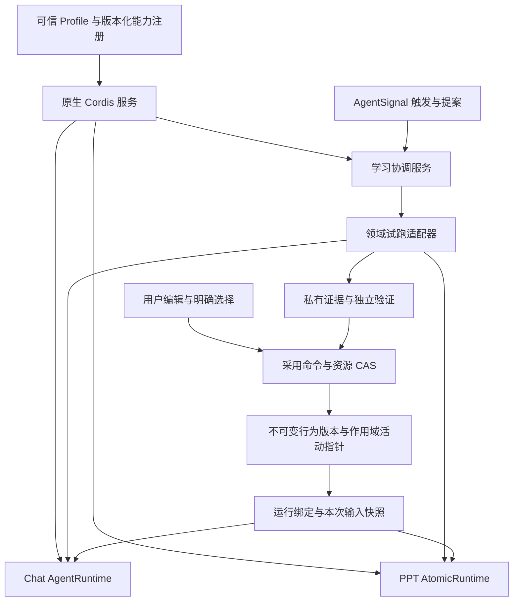

# Qingzhou 下一阶段：行为版本、运行快照与学习采用

日期：2026-10-22。本文记录架构复核与分阶段设计；A 的首个实现增量见[行为版本与运行快照记录](harness-behavior-snapshots.zh-CN.md)，B 见[可信写入与原子采用记录](harness-publication-cas.zh-CN.md)，C 的服务端纯文本机制见[受管技能实现记录](harness-managed-skills.zh-CN.md)，D 的首个预算及经验接入增量见[共同预算与经验命令](harness-common-budget.zh-CN.md)，E 的首个提供者及产品机制增量见[版本化材料提供者](harness-material-capabilities.zh-CN.md)。真实质量、账号浏览器、文件保留/删除与生产多进程验收及自动付费实验策略仍为后续目标。以下架构观察来自设计时的工作树静态调用链，不代替实现验收。

后续同日的独立环境、真实模型、PostgreSQL 多进程和生命周期验收见[验收记录](harness-acceptance-lifecycle.zh-CN.md)。其中真实候选未通过留出验证，仍保留原方案；该结果不代表整体质量验收完成。
本文接续[原架构设计](cordis-harness-evolution.zh-CN.md)和[首轮实现记录](harness-core-implementation.zh-CN.md)。前者描述目标，后者限定已实现范围；本文调整下一阶段的顺序，不将已有试跑和接口测试等同于整体迁移完成。

## 1. 结论与保留项

下一步首先明确“什么可以复用、什么只属于本次运行、谁有权发布”，再开放受管技能的实验采用。现在扩大自动学习，会把配置作用域、技能来源和写入竞争一并放大。

保留原生 Cordis 的 Context、服务依赖、插件生命周期与可信 Profile 装配；保留 Chat 的 AgentRuntime、PPT 的 AtomicRuntime 和 AgentSignal 的触发/调度职责。学习系统负责提出配置变化、组织受控比较、保存证据和执行明确的采用决定。它通过 Cordis 服务参与这些流程。

继续保留：原稿及源配置、不可变实验材料、匿名比较、独立验证、预算预留、取消、明确选择和运行绑定。失败、未知、保留原方案都作为合法结果。单页被采用仍只证明该产物被选择，不能直接变为 Agent 默认能力。

## 2. 当前实现中需要先收敛的边界

### 2.1 同一个版本包含长期配置与本次运行输入

证据：[`aiAgent/index.ts`](../../src/server/services/aiAgent/index.ts) 在读取作者原始指令后，修改模型/provider、合并内置配置、追加 page/task 指令和单次 `instructions`，再创建 operation。[捕获函数](../../src/server/services/agentRuntime/harness.ts) 将已经组合的 `agentConfig` 放入版本。公共 [`HarnessScope`](../../packages/agent-runtime/src/harness.ts) 目前只有 userId/agentId。[协调器](../../src/server/runtime/improvement/coordinator.ts) 为每个 scope 保存一个 sourceRevisionId，源版本变化会清除 active；`chat.systemRole` 差分替换整个组合后的 systemRole。

推论：同一 Agent 的不同入口或单次覆盖可能改变源摘要，使已采用配置失效；整段替换还可能把宿主注入的页面/任务约束纳入候选编辑面。这里是调用链推导出的风险，尚未通过真实账号复现。不能通过简单忽略 hash 字段修复，否则会丢失运行证据。

### 2.2 受管技能文档与实际技能集合尚未统一解析

证据：普通运行的 OperationSkillSet 来自 builtinSkills 和 [`AgentSkillModel`](../../packages/database/src/schemas/agentSkill.ts) 对应的账号级技能；[`SkillManagementDocumentService`](../../src/server/services/skillManagement/SkillManagementDocumentService.ts) 管理的是 Agent 文档绑定及其 SKILL.md，创建/替换会设置 `policyLoad: DISABLED`。两者的身份、加载规则和资源模型不同。

因此，保存受管技能正文不等于它已经进入普通 Chat 的 SkillResolver。后续必须证明候选正文实际进入试跑上下文，并且采用后能按同样规则进入新运行。不能通过把两种 ID 当成同一个 ID 来完成接入。

### 2.3 学习写入来源仍依赖调用者约定

证据：受管技能服务仅在 `origin === 'agent-signal'` 且学习开关开启时转为提案。已接入的 AgentSignal 路径传入该来源，但 [`toolExecution/serverRuntimes/skillManagement.ts`](../../src/server/services/toolExecution/serverRuntimes/skillManagement.ts) 创建同一服务时未传来源。

这证明存在未标记的适配入口，不证明任意用户可触发绕过；具体可达性还需沿工具启用和调度链验证。设计上应让底层写入命令要求可信授权上下文，避免安全语义依赖每个调用者都记住一个字符串。

### 2.4 事前检查与资源提交之间仍有竞争窗口

证据：AgentSignal 的 [`runWriteTool`](../../src/server/services/agentSignal/services/selfIteration/tools/shared.ts) 分别执行 preflight 和 mutate。受管技能替换最终进入 [`AgentDocumentModel`](../../packages/database/src/models/agentDocuments/agentDocument.ts)，当前更新条件检查 ID/账号，没有接收并在 SQL 条件中比较实验绑定的内容代数。模型内部事务保护多条更新，但不构成对实验源资源的 CAS。

当前 Harness 的文件活动指针 CAS 也不等于数据库技能资源 CAS。未来采用必须在实际写入事务中重新比较源资源、活动版本和验证身份。

### 2.5 当前存储接口承载了过长的作用域租约

证据：[`HarnessStore`](../../src/server/runtime/improvement/contracts.ts) 的 transaction 是带 checkpoint 的 scope 租约；[`coordinator.execute`](../../src/server/runtime/improvement/coordinator.ts) 在回调内完成模型流程。文件提供者持有整个账号/Agent 的排他锁；取消另行记录。首轮记录已明确崩溃锁和多副本限制。

下一步不能只把这个回调换成数据库 transaction。应拆成短命令事务、按实验租约和不可变证据存储，避免模型等待阻塞该 Agent 的其他提案、登记或选择。

### 2.6 公共协议已经出现，但扩展能力尚未充分验证

证据：PPT 的 [`trial-learning.ts`](../../src/server/runtime/presentation/trial-learning.ts) 生成共同经验投影，仍以 `presentation:${sessionId}` 填入 agentId；预算、渲染、采用流程仍在领域实现。Chat 的 [`context-strategy.ts`](../../src/server/runtime/improvement/context-strategy.ts) 通过原生 Cordis 服务接入，但当前只是注册的字符串变换，差分面仍由协调器静态声明。

现有策略证明了服务接入路径，尚不能证明任意技术实现都能版本化替换、固定旧运行、声明副作用并受同一实验约束。PPT 的成熟领域流程应保留；共同协议的目标是相同不变量，而非强行使用同一个 Chat 执行器。

## 3. 目标结构：一个服务体系，两类执行器

模型提出数据差分；可信宿主决定可编辑面、预算、权限、提供者和提交资格。Cordis 管理服务生命周期；持久化调度、远程调用记账和崩溃恢复由相应存储/调度服务承担。

### 3.1 三个明确对象

**行为版本（沿用 HarnessRevision，升级 schema）**：可复用的作者配置、已解析的技能版本引用、上下文策略配置、能力契约及实现版本。每个编辑面声明所有者和约束。实现版本包含实际发布身份，不能只记录一个长期不变的名称。

**运行快照（RunSnapshot）**：本次入口、任务指令、页面/主题输入、模型覆盖、设备绑定和实际读取材料，以及最终发送的上下文/调用参数证据。其完整性仍受摘要保护，但不会因一次任务输入变化改写 Agent 默认源版本。凭证和可执行句柄不进入快照；私有正文仍遵循账号访问与保留策略。

**运行绑定（RunBinding）**：关联行为版本、运行快照、实际提供者版本、执行模式与采用决定。一次运行及其续跑固定这些引用；权限撤销继续实时生效。已固定资源被删除或提供者不可恢复时明确失败，不静默加载最新版本。

提示词在组合前保留来源段：作者指令、可信宿主约束、任务输入、检索材料。候选只修改声明的作者段；宿主约束由编译器重新组合。模型输出不能把普通材料升级为宿主指令。

活动指针按“账号 + 领域主体 + 执行模式/配置档”寻址，并声明模型/能力兼容要求。任务 ID 不作为永久活动指针维度；同一语义模式的任务变化不生成新的默认配置。配置档必须由宿主定义，不能由候选自行扩大适用范围。

### 3.2 执行一致性是契约，不以复用类名代替

提取普通执行与 probe 共用的配置解析/上下文编译步骤。记录所有有意不同的参数：例如纯文本 probe 禁用工具、裁剪输入、限制输出；它只为该受限任务类型提供验证资格。

验收比较实际模型请求的上下文、技能正文、策略和有效模型参数；仅允许 manifest 声明的实验差异。包含检索、动态工具或外部写入的配置不能因为纯文本测试通过，就被声明为整套能力已验证。

v1 operation 保持原读取路径；新运行先双写/影子比对 v2 投影，不触发额外模型调用。旧证据保留原 schema；缺少来源段的旧版本不能直接转成可编辑 v2 候选，需重新捕获。

## 4. 受管技能：先建立运行材料，再建立学习闭环

引入来源明确的 SkillRevisionRef，包含 sourceKind、resourceId、可选 bindingId、所属作用域、contentDigest/revisionId 和资源清单引用。由 builtin、账号技能、受管文档三种解析器产出共同的不可变技能材料，仍交给现有 SkillResolver/上下文管线。

目录可见、正文激活、自动装载和编辑是独立动作。首次接入只允许“已有受管纯文本技能正文替换”，保留原标识、加载策略和资源关系；暂不允许候选创建/重命名技能、修改脚本或资源文件。动态激活也必须解析绑定版本，不能取最新正文覆盖已固定的内容。

端到端流程为：源资源快照 → 候选差分 → 私有运行材料覆盖 → 有界试跑 → 匿名比较 → 未见任务验证 → 用户选择 → 资源 CAS 提交 → 新运行加载新版本。候选落入私有材料区，不修改正在使用的文档。

经验继续保存完整原/候选配置引用、差分、输入、输出、评价、选择、采用结果、适用条件和失败原因。模型总结只作为检索索引；执行恢复使用完整材料。把运行结果、验证结果、用户选择、发布状态分别保存，避免一个 `success` 字段同时代表四件事。

任务选择和质量标准在实验开始前登记。候选生成器不读取独立验证任务与评价回执；匿名选择器不接收候选来源和候选指令。独立验证失败不回传到同一轮候选改写中；任何新一轮实验使用新的未见任务和新预算。

## 5. 写入授权与原子采用

用可信 MutationAuthority 取代可选 origin 字符串。授权在认证入口、明确用户操作或已验证采用命令处构造；模型工具参数不能自称 `user_edit`。明确用户编辑可以继续直接保存，但必须参与同一资源代数检查。未分类的自动写入只生成提案或被拒绝。

采用命令携带 requestId、候选摘要、验证清单摘要、expectedSourceGeneration、expectedActiveGeneration 和具体资源 expectedGeneration。提交分为：

1. 事务外写入不可变候选材料并验证可读性。
2. 短数据库事务内校验账号权限、授权、源资源和活动代数、候选/验证对应关系及幂等键；更新指定资源或活动指针，记录决定与待投递事件。
3. 提交后刷新缓存并通知新运行；通过事务 outbox 补偿事件投递失败，不重复执行采用或模型调用。

资源变更、决定和代数推进必须同成同败。事务失败留下的未引用材料由保留任务清理。现有 AgentSignal receipt 不直接当作事务 outbox；二者应通过引用关联。

实施时盘点即时反思、夜间 review、brief、隐藏技能工具、手工文档/VFS 和全局技能编辑。共享底层写入入口执行同一授权与代数检查。回滚创建新的发布代数并指向已保存版本；它不撤销外部动作，也不改写已经开始的运行。

## 6. 存储、预算和恢复的共同不变量

将当前长回调接口逐步替换为不可变版本/证据仓库、短事务命令仓库、实验租约三个职责。可以由同一 PostgreSQL 提供者实现，无需拆成微服务。通过可信 Profile 注入原生 Cordis 服务；文件实现保留用于开发和迁移，但明确其一致性级别。

每个实验有独立租约和 fencing token；迟到进程不能提交旧代数的结果。源资源/活动指针只在短提交中锁定。恢复分清“未分发”“已分发但未知”“已完成”：未知调用保留预算预留，不因进程重启自动重发付费请求。

共同 BudgetLease 覆盖提案、probe、选择与验证的所有付费子调用。父预算原子分配子预算；同一供应商请求仅记一次费用。分别保存预留上界、实际 token、供应商费用和未知状态，明确何时允许退还，不能把估算金额当实际账单。CPU/内存并发额度仍由现有 resource-budget 管理。

取消先落持久状态，再传播 abort；不接收取消后的采用结果。供应商不保证取消到账单归零，因此未知费用继续占用预留。恢复和重试采用唯一 attempt 身份；新付费尝试需要可用预算及明确调度策略。

完整快照避免无限内联复制：正文放私有不可变材料仓，操作状态保存引用与摘要。证据设置账号级保留策略、配额、访问控制和删除任务；内容去重不能绕过租户授权。普通运行、学习档案与采用依据有不同保留期，采用中版本不能被常规历史清理误删。

## 7. PPT 迁移与后续技术接入

公共主体改为可辨识的领域联合类型：Agent 主体和 Presentation 主体各有自己的真实 ID，账号作为共同租户边界。停止新增伪装成 agentId 的页面会话主体；旧 sidecar 使用兼容读取，不重写证据身份。

领域适配器声明 surface、材料解析、执行、评价资格和提交类型。PPT 的 ArtifactFork 与 Agent 的 BehaviorActivation 使用不同采用策略，共享来源校验、预算、证据引用和幂等规则。先迁移只读投影及影子核对，再逐条接入公共命令；原渲染器、边界控制、原稿保护及领域验证保留。

能力 manifest 由可信插件声明：contractVersion、implementationVersion、配置 schema、编辑面、副作用类别、取消/用量能力及回放限制。模型只能选择已注册实现并改变允许的参数。新的实现先通过资格测试，再进入实验候选集合。

真正的扩展验收选用“受管技能材料解析器/受限只读检索策略”这类会影响实际材料的能力，而不只追加一句提示词。要求在既有 Cordis 服务契约下接入，旧实现继续可选；旧运行固定旧实现，新运行才读取新的活动指针。移除仍被运行引用的插件应拒绝卸载或等待排空，不能热切换旧运行。

纯协议放共享 package；服务端协调留在 `src/server/runtime/improvement`；领域规则留在 Chat、技能与 Presentation 模块。先证明两个领域真正共有的规则，再抽取实现。

## 8. 建议执行顺序与验收闸门

### A. 分开行为版本与运行输入（立即下一步）

改动公共版本契约、源配置捕获、提示词分段和解析、scope 兼容规则；普通执行/probe 接入同一配置投影。先影子记录并比对，再切换新 operation；保留 v1 恢复。

验收：同一 Agent 连续普通 Chat/page/task 不互相清除适用的活动配置；单次 instructions/model override 不污染作者源；候选替换作者段后仍保留宿主约束；用户修改作者配置使不兼容采用失效；续跑固定旧材料；跨账号和不完整材料仍被拒绝。首个增量不增加模型调用或自动写入面。

### B. 收敛采用授权与持久化提交

建立可信写入上下文、资源 generation、短事务采用命令及原生存储提供者；先把已有指令采用迁入，再覆盖技能写入入口。普通运行捕获和读路径不得依赖长实验锁。

验收：两次并发采用仅一次成功；人工编辑与采用冲突返回 stale；决定、资源、活动指针一致；重复请求幂等；缺失授权的工具入口不能直接写；租约失效和提交后通知失败可恢复且不重复付费。

### C. 打通一个受管技能的真实使用闭环

来源明确的 SkillRevisionRef、版本固定的正文解析、已有纯文本技能替换 surface、私有覆盖和领域验证。保留手工编辑及原技能版本。

验收：实际模型输入含候选正文；至少分别覆盖候选胜出、保留原方案、验证失败、未知评价、并发编辑、取消；采用只影响符合范围的新运行；旧运行及动态激活读取旧版本。真实质量验收使用登记任务和固定预算，不以确定性 mock 输出代替业务效果。

### D. 共同预算与经验命令接入 AgentSignal / PPT

统一父子预算和回执身份、领域主体及采用类型；AgentSignal 使用既有调度器，PPT 逐步消费公共命令。自动付费实验仅在父预算、明确用户策略和恢复语义全部就绪后开放。

验收：反思加试跑加验证不超父额度；异常/未知调用不被退款重试；取消跨阶段生效；PPT 原稿、新产物版本与旧证据可读；选中页面不改变全局行为默认值。

### E. 验证扩展性与真实产品路径

接入一个有实际材料变化的新能力实现，执行插件契约测试，再完成真实账号、模型和浏览器验证；覆盖账号保留/删除与所需部署拓扑。

验收：新增提供者无需给 Chat/PPT/AgentSignal 各写一套策略分支；行为版本可复现、回滚可解释；对比 UI 明确显示作用范围、源版本变化和采用结果；多副本预算/租约测试与真实模型质量测试分别报告。

每个增量独立审查和定向回归。A 完成后检查边界是否成立，再推进 B；不能以五个目录或接口都存在作为五步完成标准。

## 9. 本轮交付边界

本轮仅新增此设计稿，保留工作树已有代码。静态核查发现的是具体结构与相应推论；并发竞争、跨入口源版本变化和真实插件替换仍需上述回归证明。没有调用付费模型、切换部署开关或重跑上一轮测试；此前的测试数量不作为本轮验证结果。
