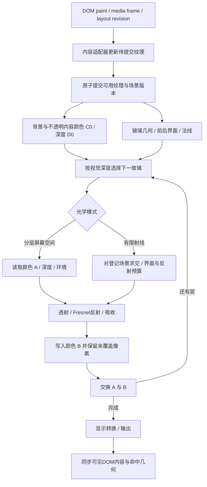

# 清舟液态玻璃：光学基础与三维渲染架构

研究日期：2026-11-08。本文记录原始技术资料、实现边界和建议架构。二维光学是兼容基础，三维部分是待验证设计；不代表清舟已经具备文中全部能力。当前选择自行实现小型数学与渲染层，不直接复制或安装第三方玻璃库。

## 1. 先区分三种能力

| 路线             | 实际输入                       | 能做到                                              | 必须承认的边界                                              |
| ---------------- | ------------------------------ | --------------------------------------------------- | ----------------------------------------------------------- |
| CSS 模糊与半透明 | 浏览器背景合成图               | 磨砂、染色、视觉分层                                | 没有曲面折射                                                |
| SVG 位移光学     | 当前玻璃之前绘制的实时背景     | 根据曲面法线弯折真实文字、图片和下层玻璃            | 只有二维颜色，没有场景深度或完整光路                        |
| 三维玻璃渲染     | 显式几何、材质、光照和场景纹理 | 入射/出射界面、视角变化、厚度、反射、遮挡、多层透射 | 取决于实际纳入场景的对象；不能自动读取任意 DOM 或被遮挡信息 |

“周围、下方、上方”需要分开定义：下方已绘制内容可以成为背景折射源；周围内容可通过扩大采样范围进入玻璃边缘；更高层的前景若要反射进较低层玻璃，需要进入三维场景或额外反射源。提高 `z-index`、叠加 blur 或加入一个 canvas 都不会自动产生这种光路。

## 2. 二维兼容基础：从曲面到位移图

参考 [kube 的原作者推导](https://kube.io/blog/liquid-glass-css-svg/)：用距边缘的距离定义玻璃高度函数，求导得到法线，通过 Snell 定律求折射方向，再把落到背景平面的偏移编码为位移图。其演示采用正视、平行背景、单次界面折射等简化；它是基于光学的屏幕空间近似，并非完整三维玻璃。

清舟建议使用以下独立数学约定：

1. 圆角矩形距离场提供边缘距离与二维方向；高度函数提供局部高度和坡度，中心平台坡度为零。
2. 空气到玻璃的折射率比以空气为 1、玻璃约为 1.5 起步，实际数值作为材质参数。
3. 视线垂直背景时，入射角由坡度决定，折射角由 Snell 定律决定；局部高度乘折射后横向斜率，得到背景采样偏移。
4. 只在曲面边缘产生明显偏移，中心保持可读。沿不同边和圆角使用对应方向，不能拿一个全屏渐变或噪声场冒充曲面法线。

SVG 图为 `feImage → feDisplacementMap`：`in` 使用 `SourceGraphic`，`in2` 使用本地生成的位移图。后续低强度模糊与染色是材质修饰，不能替代位移。

必须按 [MDN 的实际公式](https://developer.mozilla.org/en-US/docs/Web/SVG/Reference/Element/feDisplacementMap)处理比例：

```text
sampleX = x + scale * (R - 0.5)
sampleY = y + scale * (G - 0.5)
```

其中 R/G 是 0–1 通道值。若最大目标偏移为 D、编码为 `0.5 + displacement / (2 * D)`，则 SVG 的 `scale` 应为 `2 * D`。不要沿用把偏移范围描述成 ±scale 的教程文字。采样偏移和画面中纹理移动方向相反，也应通过网格验证。

使用 `color-interpolation-filters="sRGB"` 保持编码空间一致；默认 linearRGB 会改变中性灰含义。8 位图的中性值有量化误差，应在强位移下检查中心漂移。零尺寸 SVG 定义应保持在可渲染 DOM 中，不用 `display:none` 隐藏。

## 3. 层级、裁剪与真实背景

[CSS Filter Effects Level 2 草案](https://drafts.csswg.org/filter-effects-2/#BackdropRoot)将 backdrop 定义为最近 backdrop root 与当前元素之间，按绘制顺序扁平化后的二维图像。它不包含稍后绘制的前景，也不保留各对象深度。该规范仍是工作草案，实际内核需要验证。

以下祖先属性会形成背景采样边界：非 none 的 `filter` / `backdrop-filter` / mask / `clip-path`，小于 1 的 `opacity`，非 normal 的混合模式，以及对应的 `will-change`。`backdrop-filter` 还会建立固定定位后代的包含块。因此玻璃材料应放在绝对定位的独立背景层，宿主和全局 AppTheme 不承担滤镜；内容、图标和可交互控件位于其上。多块玻璃优先在同一采样根中按视觉深度排列，避免把整页包进一个滤镜容器。

从规范上看，transform 或普通 stacking context 本身不等同于 backdrop root；不能把两者混为一谈。但组合层、裁剪和特定内核实现仍可能改变实际结果，应以嵌套、滚动和拖动测试为准。

[Nordify 作者的实现说明](https://github.com/nordify/css-liquid-glass/blob/main/HOW-IT-WORKS.md)提供一个周边采样方案：扩大实际光学层的矩形范围，再把结果遮罩回玻璃轮廓。它可让邻近像素进入边缘，但仍只处理已绘制的屏幕图像。祖先 `overflow:hidden` 会截掉扩出的区域；只增大 SVG filter region 并不等于扩大实际背景输入。作者还报告了 Display-P3 下位移图色彩转换问题，真实 Mac 屏幕应单独检查，不能只依赖 headless 截图。

## 4. 浏览器能力与降级

SVG `feDisplacementMap` 本身广泛可用，不代表 `backdrop-filter: url(#svg)` 的组合在所有浏览器都可用。[WebKit 的跟踪问题](https://bugs.webkit.org/show_bug.cgi?id=245510)仍记录该组合的兼容性工作。目标 Chromium/Electron 应做实际光学验证；Safari/WebKit、Firefox 路径默认保留可读的磨砂材质，不能把语法解析成功当作折射生效。

2026-10 的 Chromium 安全修复没有全面禁用背景折射。检查 [当前 Chromium 实现](https://raw.githubusercontent.com/chromium/chromium/main/third_party/blink/renderer/platform/graphics/filters/fe_displacement_map.cc)可见，禁用条件针对位移输入 `InputEffect(1)` 含背景或被污染的情况；[对应 WPT](https://github.com/web-platform-tests/wpt/pull/64056/files)也将背景放在 `in2`。清舟应始终用自行生成的图作为 `in2`，不要拿背景像素反向生成位移图。

降级需要分别处理：不支持 SVG backdrop、GPU/context 丢失、减少透明度偏好、增加对比度偏好。减少动态效果时停止非必要动画，静态几何可以保留。能力状态应可观察，便于测试区分“正在折射”和“只显示磨砂”。

## 5. 三维目标：物理模型的最低要求

完整几何光学必须描述光从哪里来、在何处进入/离开玻璃以及离开后遇到什么。仅增加一条法线贴图，不能补齐缺失的第二界面和场景。

- **界面与能量**：入射方向、表面法线和两侧折射率决定折射方向；Fresnel 系数决定反射/透射比例。射线从内部离开时应交换介质并检查全反射，不能总使用空气到玻璃的比值。[PBRT：镜面反射与透射](https://www.pbr-book.org/4ed/Reflection_Models/Specular_Reflection_and_Transmission)
- **玻璃体积**：应有封闭、方向一致的表面，或明确的解析体积模型；计算实际进入与离开位置。平行薄片可以采用专门近似，但不能用它代表任意厚曲面。薄片的多次内部反射也会改变总反射率。[PBRT：Dielectric BSDF](https://pbr-book.org/4ed/Reflection_Models/Dielectric_BSDF)
- **吸收与粗糙度**：光路长度控制颜色衰减，粗糙度影响透射和反射分布。厚度纹理是有损距离近似，射线追踪应使用真实交点距离。[Khronos：KHR_materials_volume](https://github.com/KhronosGroup/glTF/blob/main/extensions/2.0/Khronos/KHR_materials_volume/README.md)
- **环境与多次交互**：屏幕空间颜色只能描述某一视角已渲染的信息。要处理屏外反射、背后遮挡或玻璃之间的多次反射，需要完整场景几何、可用纹理和额外光路采样；多 pass 本身不保证物理正确。

用于 UI 的合理目标是可控场景中的几何光学，而不是宣称波动光学、焦散与任意次数散射均已解决。应以离线参考图或高质量静态参考验证实时近似，再明确记录省略的路径。

## 6. three.js 和 Filament 能提供什么

[three.js MeshPhysicalMaterial 源码文档](https://github.com/mrdoob/three.js/blob/dev/src/materials/MeshPhysicalMaterial.js)提供 transmission、ior、thickness、粗糙度、吸收及环境反射等参数。物理透射不等同于降低 opacity；它适合快速建立玻璃外观原型，但材质名称不能证明完整光路已经求解。

[实际 transmission shader](https://github.com/mrdoob/three.js/blob/dev/src/renderers/shaders/ShaderChunk/transmission_pars_fragment.glsl.js)用折射方向与厚度估算出口，再把出口投影到二维 transmission buffer 采样。它没有对任意第二曲面执行射线求交。[WebGLRenderer 预通道](https://github.com/mrdoob/three.js/blob/dev/src/renderers/WebGLRenderer.js)主要绘制不透明对象，并存在特定双面材质背面的补充路径；一般透明物体和任意多层玻璃不会自动成为完整递归透射源。这是基于源码的边界判断，具体版本可能变化。

[Filament 材质文档](https://google.github.io/filament/main/materials.html#materialdefinitions/materialblock/blendingandtransparency:refractionmode)明确区分：cubemap 模式只折射环境；screenspace 模式能折射已渲染的不透明场景，但有出射方向假设。solid/thin 也采用各自简化的体积形状。它值得作为材质参数、能量和性能取舍的参考，而非接入后自动实现所有 DOM 相互反射的方案。

## 7. 三维渲染架构建议（尚未实现）

建议定义可替换的渲染能力，而不是让业务组件依赖某个 GPU 库：

| 模块       | 责任                                                                |
| ---------- | ------------------------------------------------------------------- |
| 场景登记   | 登记玻璃轮廓、位置、视觉深度、厚度、材质、源内容和更新版本          |
| 内容适配器 | 提供图片/视频/canvas/受控 DOM 子树纹理，明确每类来源的实时性与权限  |
| 光学模型   | 共享圆角曲面、法线和材质参数，提供二维位移与三维几何两种输出        |
| 渲染器     | 按能力选择 SVG、WebGL/WebGPU 或可读的无折射材质                     |
| 交互与语义 | 保留 DOM 表单、焦点、选择、输入法和辅助功能；同步可视几何与命中范围 |

可先建立一个局部三维舞台：使用封闭圆角玻璃几何、统一相机和光源，把允许参与折射的内容变成明确的场景平面。正交相机利于与现有二维布局对齐；透视模式应单独设计，避免元素尺寸与命中位置漂移。

实时管线可以依次生成背景颜色/深度、玻璃前后界面或解析交点，再按深度合成透射与反射。多块玻璃通过独立中间目标按顺序组合，不能读写同一纹理。屏幕空间射线未命中时必须有明确的环境或无折射退化策略。该路线可以表现有限层级，仍不等于双向无限递归的光传输。

更高质量路线需要场景求交结构与受限反弹追踪：明确最大界面次数、剩余能量终止、粗糙采样和时间累积策略。UI 交互时的历史纹理失效必须处理，否则拖动、输入和歌词滚动会留下残影。质量档位应由设备实测确定，而不是承诺所有硬件固定帧率。

### 7.1 场景登记契约

以下是三维原型的设计契约，不是已经导出的运行时 API。边界矩形用视口 CSS 像素；正交相机下约定 1 个场景单位对应 1 CSS 像素，Z 增大朝向观察者。CSS `z-index` 不能直接当物理距离。

```ts
type Revision = number; // 单调增加；每次登记生命周期从 0 开始
type Vec2 = readonly [number, number];

type ContentSource =
  | { kind: 'none' }
  | {
      kind: 'dom-drawable';
      canvas: HTMLCanvasElement;
      element: HTMLElement;
      revision: Revision;
    }
  | {
      kind: 'media';
      element: HTMLImageElement | HTMLVideoElement | HTMLCanvasElement;
      revision: Revision;
    }
  | { kind: 'scene'; sceneId: string; revision: Revision };

interface GlassSceneRegistration {
  id: string;
  owner: HTMLElement; // 交互与生命周期归属，不表示可以截图该元素
  contentSource: ContentSource;
  bounds: {
    x: number;
    y: number;
    width: number;
    height: number;
    clip: readonly [number, number, number, number] | null;
    revision: Revision;
  };
  shape: {
    kind: 'rounded-rectangle';
    radii: readonly [Vec2, Vec2, Vec2, Vec2]; // TL/TR/BR/BL，支持椭圆角
    profile: 'ellipse' | 'squircle';
    bezel: number;
    revision: Revision;
  };
  depth: {
    frontZ: number; // 玻璃后表面为 frontZ - thickness
    band: 'shell' | 'content' | 'chrome' | 'capsule' | 'popover' | 'modal';
    order: number; // 同一深度的稳定绘制次序，不伪造物理间距
    modalScope: string | null;
    revision: Revision;
  };
  material: {
    ior: number;
    thickness: number;
    roughness: number;
    absorptionPerUnit: readonly [number, number, number]; // 在线性光空间计算
    transmission: number;
    revision: Revision;
  };
  sampling: {
    mode: 'backdrop-2d' | 'layered-screen-space' | 'bounded-rays';
    maxInterfaces: number;
    maxReflectionBounces: number;
    sourceIds: readonly string[]; // 实际存在并允许参与光路的源
    environmentId: string | null;
  };
  visible: boolean;
}

interface GlassSceneRegistry {
  register(initial: GlassSceneRegistration): {
    update(next: GlassSceneRegistration): void;
    dispose(): void;
  };
}
```

`bounds` 位置变化只更新投影和命中；`shape` 或光学材质变化才重建相应几何/位移缓存；`contentSource.revision` 使源纹理失效。任何新版本必须作为完整快照提交，渲染帧不能把新版 bounds 与旧版深度混用。源适配器在完成上传后公布可用 revision；卸载或更新之后到达的旧异步结果一律丢弃。

### 7.2 清舟相对深度约定

以下数值是原型初始场景单位，可以统一缩放。它们描述视觉前后关系，不替换现有应用的焦点、模态和 CSS 层级规则。

| 层                           | 建议前表面 Z | 行为                                                 |
| ---------------------------- | -----------: | ---------------------------------------------------- |
| 环境背景                     |            0 | 提供背景颜色与低频环境光                             |
| 主壳                         |            4 | 材料厚度不超过 2；先于内容绘制                       |
| 聊天正文、资源内容、音乐封面 |            8 | 内容面默认不折射自身，作为上层可用源                 |
| 侧栏、标题栏等导航控制       |           16 | 只在实际覆盖区域影响后方内容                         |
| 输入框与页内播放控制         |           24 | 保留独立可读的文字/输入交互面                        |
| 常驻音乐胶囊                 |           40 | 在普通页面上方，不能越过活动模态抢占点击             |
| 普通浮层和菜单               |           64 | 折射已登记的下层；其内容单独置于面上                 |
| 模态遮罩                     |           80 | 先合成变暗后的下层场景，不反射用户尚未允许纳入的来源 |
| 模态面板                     |           96 | 开启独立 modalScope，背景操作保持 inert              |
| 模态内部弹出菜单             |          112 | 属于同一 modalScope，不能与普通页面菜单混排          |

同一 Z 层可以有稳定 order；彼此交叠的玻璃若需要物理体积，应保证后表面不穿插。若产品选择让音乐胶囊在模态期间持续可见，应显式设计为非阻挡层，而不是为了折射效果改变模态交互语义。

### 7.3 渲染图与缓冲区



必须分清两种双缓冲：内容源的 staging/live 纹理用于避免未上传完成的版本被采样；颜色 A/B 用于每个玻璃 pass 的读写隔离。某一 pass 不能读取自己正在写入的纹理。颜色 A 从 C0 开始，B 必须保留未覆盖区域，交换后下层玻璃的结果才成为上层输入；单纯交换两块局部绘制的未初始化纹理会丢掉背景。

深度/法线应保持明确含义，不能把透明玻璃的最近深度覆盖成“不透明遮挡”后让所有后续射线提前结束。三维原型应独立保存不透明深度和各玻璃界面，或使用解析几何求交。屏幕空间模式只有当前视角数据，有限射线模式才查询完整的已登记几何；两者共用材质与输出阶段，不宣称有相同准确度。

初始有限光路决策：基础玻璃路径处理入射与出射两界面；更高质量档可增加第二块玻璃的两界面，反射最多 2 次，低于 1% 的剩余能量终止。全反射消耗反射预算，不应被错误画成黑色透射。预算耗尽后使用明确的环境近似，并在调试状态中标记，不能把剩余能量凭空加入另一条路径。上述有限截断有偏差，需与高质量静态参考比较后调整。

内容纹理、几何或相机版本变化时，相关时间累积失效；拖动和输入期间优先避免残影。先以不依赖跨帧累积的清晰版本验证，再增加粗糙反射采样、降噪和自适应质量。

## 8. DOM 到 GPU：新的 API 仍有边界

[Chrome 官方发布说明](https://developer.chrome.com/blog/html-in-canvas)于 2026-10-26 宣布 HTML-in-Canvas 在 Chrome 157 stable 发布。本次工作中宿主 Chrome 版本信息为 156.0.8078.81；实际 headless 运行时探测确认有 WebGPU，但没有 HTML-in-Canvas、`drawElementImage` 或 `updateElementGeometry`。没有开启实验开关，当前默认仍为 SVG 二维路线；三维先限定为可控内容/音乐舞台原型。不能把新版本文档当作当前环境已经支持的证据。

[官方概念文档](https://developer.chrome.com/docs/web-platform/html-in-canvas/concepts?hl=en)要求 `canvas content="drawable"` 与被绘制后代的 `drawable` 标记；这是受控子树机制，不是整个浏览器页面截图 API。`paint` 事件可通知发生变化的子树。三维环境还需要 `updateElementGeometry()` 同步命中与辅助功能几何，纹理变形本身不会自动提供正确交互。

[官方 WebGPU 文档](https://developer.chrome.com/docs/web-platform/html-in-canvas/webgpu?hl=en)给出 `GPUQueue.drawElementImageToTexture()`，包括预分配纹理和按子矩形更新。它有望消除手工 DOM 截图方案的一部分开销，但仍需要清舟重新组织可绘制源层，管理颜色空间、预乘 alpha、尺寸和刷新时机。

[WICG explainer](https://github.com/WICG/html-in-canvas)仍持续演进：drawable 是独立绘制根，嵌套 drawable 需单独绘制；不能把跨源 iframe 等受限内容当作自由可读纹理。旧示例中的 `layoutsubtree` 不应直接用于当前 API。滚动、焦点、输入法、文本选择、portal 弹层和降级布局都必须进入试验范围。

另一个跨浏览器参考是 [Aave 的原作者实现说明](https://aave.com/design/building-glass-for-the-web)：它把普通 `filter` 作用在内容自身的像素上，而非采样任意 backdrop；受控源层可取得折射效果，但这会改变内容组织方式。不能把该结果推广成现有清舟任意浮窗都能无成本折射整页。

## 9. 性能与验收

这些是清舟的工程建议，需随实际测量调整：

- 同一场景共用渲染调度；几何更新与内容更新分开。仅位置变化不重新生成位移图；尺寸或曲率变化才使对应缓存失效。
- 图像尺寸按效果所需限制，重复形状可使用边/角分块或缓存；不要对资源列表每一项都建立独立连续 GPU 渲染循环。
- GPU 层限制同时可见玻璃数、处理分辨率和光路次数；重用渲染目标，退出路由释放资源。普通 CSS 模糊与自定义折射不要在深层祖先重复叠加。
- 明确颜色空间：位移数据、线性光照与最终显示色彩各自处理；不能把法线/偏移当作普通彩色图片随意转换。
- 光学验收使用移动网格、文字、彩色边界和不同深度面，确认中心稳定、边缘弯曲方向、重叠顺序、周边采样与前景排除。测试拖动、滚动、窗口缩放及真实 P3 屏幕。
- 三维额外验收双界面、全反射、厚度吸收、视角变化、屏外射线、透明叠层、历史失效与设备丢失；结果与物理参考比较，分别记录近似误差和渲染错误。
- 可读性与交互验收覆盖明暗主题、最复杂背景、键盘焦点、减少透明度/动态偏好。输入框、播放器操作和聊天选择不能依赖材质才能辨认。

### 本次验证记录（2026-11-08）

- 能力探测原始结果位于本地 `.data/music-m2-validation/glass-capabilities.json`：HeadlessChrome 156，`webgpu: true`，其余 HTML-in-Canvas 相关探测为 false。此文件是本地验证产物，不作为发布时能力判断。
- 主任务验证了 15 个 optics 数学用例及 105 个相关回归用例，完整类型检查通过。
- 主任务像素对照验证：有位移与零位移的边缘平均 RGB 差异大于 3，中心和前景差异小于 1；移动背景能改变玻璃结果。减少透明度与高对比度切换能清理光学层并恢复可读降级。
- 这些证据证明当前二维位移确实作用于实时背景，不能证明三维双界面、场景互反射或所有显示色域已经通过验收。P3 实屏和三维方案仍按各自验收项验证。

## 10. 检索到的开源技能与使用决定

以下仅作为已读研究资料，未安装、未执行其脚本，也未完成整个仓库的安全审计：

| 来源                                                                                                                                                                                                                                    | 有用之处                                    | 本项目决定                                              |
| --------------------------------------------------------------------------------------------------------------------------------------------------------------------------------------------------------------------------------------- | ------------------------------------------- | ------------------------------------------------------- |
| [deepika-builds/liquid-glass SKILL](https://github.com/deepika-builds/liquid-glass/blob/main/SKILL.md) 与 [实现](https://github.com/deepika-builds/liquid-glass/blob/main/liquid-glass.js)                                              | 封装了生命周期、降级和 sRGB 注意点          | 位移场是渐变加中性内区，不是 Snell 曲面求解；不直接复制 |
| [Chiytako/liquid-glass-ui SKILL](https://github.com/Chiytako/liquid-glass-skills/blob/main/liquid-glass-ui/SKILL.md) 与 [配方](https://github.com/Chiytako/liquid-glass-skills/blob/main/liquid-glass-ui/references/css-svg-recipes.md) | 分层、可读性、性能与降级组织                | 默认湍流配方不满足曲面光学目标；只取审查思路            |
| [simple-liquid-glass SKILL](https://github.com/lucaperullo/simple-liquid-glass/blob/main/skills/simple-liquid-glass/SKILL.md)                                                                                                           | 解释 SVG/WebGL 路径及受控 backdrop 来源     | 绑定该库的 API；HTML/media 刷新语义不同，不直接引入     |
| [Meniscus 作者文档](https://github.com/thanhphuchuynh/meniscus/tree/main/packages/meniscus)                                                                                                                                             | Snell 曲面、按层组合、媒体 WebGL 的参考设计 | 可比较模型与测试案例，不能据其宣传代替本项目实测        |

最终建议：以自行实现、可检验的二维 Snell 位移作为普遍基础；同步设计受控内容源和三维场景接口，先在音乐局部舞台验证双界面与层级，再考虑更大范围。当前可交付材质与未来三维能力在命名、测试和说明中保持明确区别。
