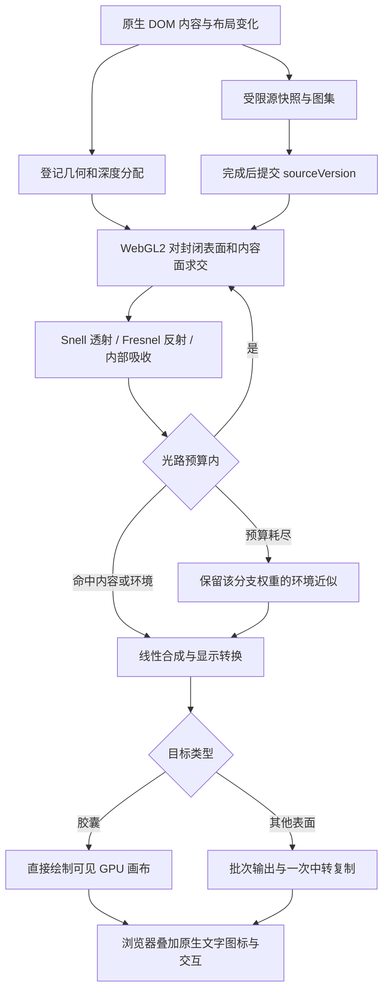

# 清舟液态玻璃：光学基础与三维渲染架构

更新日期：2026-11-08。清舟已实现自行编写的 WebGL2 三维玻璃管线：对封闭圆角体积的前后表面求交，追踪有界的折射、反射和吸收；SVG 二维折射与磨砂材质保留为降级。三维几何和光路是真实计算，内容来自受限的 DOM 快照，二者的更新频率与能力边界分别说明。未直接复制或安装第三方玻璃库。

## 1. 先区分三种能力

| 路线             | 实际输入                       | 能做到                                                | 必须承认的边界                                              |
| ---------------- | ------------------------------ | ----------------------------------------------------- | ----------------------------------------------------------- |
| CSS 模糊与半透明 | 浏览器背景合成图               | 磨砂、染色、视觉分层                                  | 没有曲面折射                                                |
| SVG 位移光学     | 当前玻璃之前绘制的实时背景     | 根据曲面法线弯折真实文字、图片和下层玻璃              | 只有二维颜色，没有场景深度或完整光路                        |
| 三维玻璃渲染     | 显式几何、材质、光照和场景纹理 | 入射 / 出射界面、视角变化、厚度、反射、遮挡、多层透射 | 取决于实际纳入场景的对象；不能自动读取任意 DOM 或被遮挡信息 |

“周围、下方、上方” 需要分开定义：下方已绘制内容可以成为背景折射源；周围内容可通过扩大采样范围进入玻璃边缘；更高层的前景若要反射进较低层玻璃，需要进入三维场景或额外反射源。提高 `z-index`、叠加 blur 或加入一个 canvas 都不会自动产生这种光路。

## 2. 二维兼容基础：从曲面到位移图

参考 [kube 的原作者推导](https://kube.io/blog/liquid-glass-css-svg/)：用距边缘的距离定义玻璃高度函数，求导得到法线，通过 Snell 定律求折射方向，再把落到背景平面的偏移编码为位移图。其演示采用正视、平行背景、单次界面折射等简化；它是基于光学的屏幕空间近似，并非完整三维玻璃。

清舟二维降级实现采用以下独立数学约定：

1. 圆角矩形距离场提供边缘距离与二维方向；高度函数提供局部高度和坡度，中心平台坡度为零。
2. 空气到玻璃的折射率比以空气为 1、玻璃约为 1.5 起步，实际数值作为材质参数。
3. 视线垂直背景时，入射角由坡度决定，折射角由 Snell 定律决定；局部高度乘折射后横向斜率，得到背景采样偏移。
4. 只在曲面边缘产生明显偏移，中心保持可读。沿不同边和圆角使用对应方向，不能拿一个全屏渐变或噪声场冒充曲面法线。

SVG 图为 `feImage → feDisplacementMap`：`in` 使用 `SourceGraphic`，`in2` 使用本地生成的位移图。后续低强度模糊与染色是材质修饰，不能替代位移。

必须按 [MDN 的实际公式](https://developer.mozilla.org/en-US/docs/Web/SVG/Reference/Element/feDisplacementMap)处理比例：

```text
sampleX = x + scale * (R - 0.5)
sampleY = y + scale * (G - 0.5)
```

其中 R/G 是 0–1 通道值。若最大目标偏移为 D、编码为 `0.5 + displacement / (2 * D)`，则 SVG 的 `scale` 应为 `2 * D`。不要沿用把偏移范围描述成 ±scale 的教程文字。采样偏移和画面中纹理移动方向相反，也应通过网格验证。

实际位移图以 `128 + 254 * displacement / scale` 编码，随后用 `feComponentTransfer` 的 `slope=255/254`、`intercept=-1/254` 把字节 128 校正到严格的 0.5。使用 `color-interpolation-filters="sRGB"` 保持编码空间一致；默认 linearRGB 会改变中性灰含义。贴图最长边不超过 512，几何仍按原始 CSS 像素计算。零尺寸 SVG 定义保留在可渲染 DOM 中，不用 `display:none` 隐藏。

## 3. 层级、裁剪与真实背景

[CSS Filter Effects Level 2 草案](https://drafts.csswg.org/filter-effects-2/#BackdropRoot)将 backdrop 定义为最近 backdrop root 与当前元素之间，按绘制顺序扁平化后的二维图像。它不包含稍后绘制的前景，也不保留各对象深度。该规范仍是工作草案，实际内核需要验证。

以下祖先属性会形成背景采样边界：非 none 的 `filter` / `backdrop-filter` / mask / `clip-path`，小于 1 的 `opacity`，非 normal 的混合模式，以及对应的 `will-change`。`backdrop-filter` 还会建立固定定位后代的包含块。因此玻璃材料应放在绝对定位的独立背景层，宿主和全局 AppTheme 不承担滤镜；内容、图标和可交互控件位于其上。多块玻璃优先在同一采样根中按视觉深度排列，避免把整页包进一个滤镜容器。

从规范上看，transform 或普通 stacking context 本身不等同于 backdrop root；不能把两者混为一谈。但组合层、裁剪和特定内核实现仍可能改变实际结果，应以嵌套、滚动和拖动测试为准。

[Nordify 作者的实现说明](https://github.com/nordify/css-liquid-glass/blob/main/HOW-IT-WORKS.md)提供一个周边采样方案：扩大实际光学层的矩形范围，再把结果遮罩回玻璃轮廓。它可让邻近像素进入边缘，但仍只处理已绘制的屏幕图像。祖先 `overflow:hidden` 会截掉扩出的区域；只增大 SVG filter region 并不等于扩大实际背景输入。作者还报告了 Display-P3 下位移图色彩转换问题，真实 Mac 屏幕应单独检查，不能只依赖 headless 截图。

## 4. 浏览器能力与降级

SVG `feDisplacementMap` 本身广泛可用，不代表 `backdrop-filter: url(#svg)` 的组合在所有浏览器都可用。[WebKit 的跟踪问题](https://bugs.webkit.org/show_bug.cgi?id=245510)仍记录该组合的兼容性工作。SVG 降级路径只在已支持的 Chromium 类环境启用；其他环境保留磨砂。三维路径独立探测 WebGL2 和内容源是否可用，不按浏览器版本假设能力；不能把语法解析成功当作折射生效。

2026-10 的 Chromium 安全修复没有全面禁用背景折射。检查 [当前 Chromium 实现](https://raw.githubusercontent.com/chromium/chromium/main/third_party/blink/renderer/platform/graphics/filters/fe_displacement_map.cc)可见，禁用条件针对位移输入 `InputEffect(1)` 含背景或被污染的情况；[对应 WPT](https://github.com/web-platform-tests/wpt/pull/64056/files)也将背景放在 `in2`。清舟应始终用自行生成的图作为 `in2`，不要拿背景像素反向生成位移图。

运行时同时挂载三维与兼容路径。三维输出就绪后替换该表面的背景光学层；没有 WebGL2、内容捕获失败或 GPU 上下文丢失时，移除三维画布，恢复可用的 SVG 或磨砂材质。减少透明度、增加对比度和页面隐藏时停止三维工作并释放资源，恢复后重新捕获。`data-qz-renderer="webgl2"` 标识已启用三维的目标；场景根的 `data-qz-glass-status` 与 `data-qz-glass-error` 记录捕获、就绪或降级状态。

## 5. 三维实现的物理依据

完整几何光学必须描述光从哪里来、在何处进入 / 离开玻璃以及离开后遇到什么。仅增加一条法线贴图，不能补齐缺失的第二界面和场景。

- **界面与能量**：入射方向、表面法线和两侧折射率决定折射方向；Fresnel 系数决定反射 / 透射比例。射线从内部离开时应交换介质并检查全反射，不能总使用空气到玻璃的比值。[PBRT：镜面反射与透射](https://www.pbr-book.org/4ed/Reflection_Models/Specular_Reflection_and_Transmission)
- **玻璃体积**：应有封闭、方向一致的表面，或明确的解析体积模型；计算实际进入与离开位置。平行薄片可以采用专门近似，但不能用它代表任意厚曲面。薄片的多次内部反射也会改变总反射率。[PBRT：Dielectric BSDF](https://pbr-book.org/4ed/Reflection_Models/Dielectric_BSDF)
- **吸收与粗糙度**：光路长度控制颜色衰减，粗糙度影响透射和反射分布。厚度纹理是有损距离近似，射线追踪应使用真实交点距离。[Khronos：KHR_materials_volume](https://github.com/KhronosGroup/glTF/blob/main/extensions/2.0/Khronos/KHR_materials_volume/README.md)
- **环境与多次交互**：屏幕空间颜色只能描述某一视角已渲染的信息。要处理屏外反射、背后遮挡或玻璃之间的多次反射，需要完整场景几何、可用纹理和额外光路采样；多 pass 本身不保证物理正确。

用于 UI 的合理目标是可控场景中的几何光学，而不是宣称波动光学、焦散与任意次数散射均已解决。应以离线参考图或高质量静态参考验证实时近似，再明确记录省略的路径。

## 6. three.js 和 Filament 能提供什么

[three.js MeshPhysicalMaterial 源码文档](https://github.com/mrdoob/three.js/blob/dev/src/materials/MeshPhysicalMaterial.js)提供 transmission、ior、thickness、粗糙度、吸收及环境反射等参数。物理透射不等同于降低 opacity；它适合快速建立玻璃外观原型，但材质名称不能证明完整光路已经求解。

[实际 transmission shader](https://github.com/mrdoob/three.js/blob/dev/src/renderers/shaders/ShaderChunk/transmission_pars_fragment.glsl.js)用折射方向与厚度估算出口，再把出口投影到二维 transmission buffer 采样。它没有对任意第二曲面执行射线求交。[WebGLRenderer 预通道](https://github.com/mrdoob/three.js/blob/dev/src/renderers/WebGLRenderer.js)主要绘制不透明对象，并存在特定双面材质背面的补充路径；一般透明物体和任意多层玻璃不会自动成为完整递归透射源。这是基于源码的边界判断，具体版本可能变化。

[Filament 材质文档](https://google.github.io/filament/main/materials.html#materialdefinitions/materialblock/blendingandtransparency:refractionmode)明确区分：cubemap 模式只折射环境；screenspace 模式能折射已渲染的不透明场景，但有出射方向假设。solid/thin 也采用各自简化的体积形状。它值得作为材质参数、能量和性能取舍的参考，而非接入后自动实现所有 DOM 相互反射的方案。

## 7. 已实现的有界三维管线

实现位于 `src/features/LiquidGlass/three/`。当前后端是 WebGL2，不依赖 three.js、Filament、WebGPU 或 HTML-in-Canvas。场景采用正交视线，X 向右、Y 向下、Z 朝观察者；一个场景单位对应一个 CSS 像素。原生 DOM 继续承担文字、图标、输入、焦点、辅助功能和命中区域，画布仅作为不可交互的材料背板。

| 文件                        | 已实现责任                                                   |
| --------------------------- | ------------------------------------------------------------ |
| `geometry.ts`               | 封闭体积 SDF、解析法线、包围盒筛选、前后表面射线求交         |
| `raytrace.ts`               | CPU 参考光路、介质栈、Snell、Fresnel、全反射、吸收与路径统计 |
| `scene.ts`                  | 按实际前后顺序分配不交叉的玻璃深度区间                       |
| `shader.ts` / `renderer.ts` | 相同几何模型的 WebGL2 有界光路、线性颜色合成与显示转换       |
| `sources.ts`                | 受限 DOM / 本地图像快照、分层增量复用、合作式捕获与图集      |
| `runtime.ts`                | 场景登记、胶囊直接输出、其他表面批次输出、内容变化与生命周期 |
| `performance.ts`            | 独立像素预算、交互期间次要表面让帧、自适应捕获间隔           |

### 7.1 封闭体积与光路

玻璃由圆角矩形沿 Z 挤出，再以球面圆滑前后边缘形成。核心体积先向内收缩 `bevel`，圆滑后保持登记的外部宽、高、深度；`bevel` 不超过外部圆角半径和深度的一半。这有独立的前表面、后表面与侧壁，不能用一次二维背景偏移代替。

`geometry.ts` 与 shader 共用以下距离模型，其中 `p` 是局部坐标，`h` 是半尺寸，`b` 是圆滑半径：

```text
r = outerRadius - b
q = abs(p.xy) - (h.xy - b - r)
dxy = length(max(q, 0)) + min(max(q.x, q.y), 0) - r
dz = abs(p.z) - (h.z - b)
sdf = length(max(vec2(dxy, dz), 0)) + min(max(dxy, dz), 0) - b
```

法线来自该距离场的解析梯度。射线先过包围盒，再沿绝对距离场寻找入射或出射点，命中后做两次解析导数精修。CPU 默认误差阈值为 `0.0001` CSS 像素，GPU 为 `0.002`，GPU 每次求交最多 96 步。

介质栈决定每次界面两侧的折射率，运行时玻璃 IOR 为 1.45。Snell 定律计算折射方向，精确非偏振 Fresnel 分配反射与透射权重；玻璃到空气的出射会检查全反射。RGB 吸收按实测内部光路长度计算 `exp(-absorption * distance)`，默认系数为 `[0.0015, 0.0005, 0.0007]`。前后界面之间的路长和抗自相交的小偏移均纳入吸收。

CPU 接口为 `traceGlassScene(ray, { volumes, planes }, options)`，输出内容面 UV / 真实交点或环境方向、RGB 权重、总路长 / 玻璃内路长、界面 / 反射次数和近似标记。CPU 支持分离或完整嵌套的体积；运行时主动避免玻璃穿插，未定义任意交叉材料的混合介质。

### 7.2 登记、绘制顺序与深度

`data-qz-glass` 表面及匹配的菜单、弹层、模态内容由一个运行时登记。只选择屏幕内且可见的表面；当前支持四角相同的圆形圆角，不支持椭圆圆角、任意网格或旋转后的三维物体。未进入三维场景的目标继续使用兼容材质。

以下数值是最低前表面 Z，不是最终渲染顺序：

| 表面                   | 最低前 Z | 厚度 |
| ---------------------- | -------: | ---: |
| 主壳 `shell`           |        4 |    2 |
| 侧栏 / 标题栏          |       16 |    6 |
| 输入框 `composer`      |       28 |    8 |
| 页内播放控制 `control` |       28 |    6 |
| 音乐胶囊 `capsule`     |       48 |   12 |
| 浮层 / 菜单 / 普通面板 |       72 |   10 |
| 资源编辑器 `editor`    |       96 |   10 |

实际厚度还受元素宽、高的三分之一限制，圆滑半径至多 6。运行时按祖先关系、重叠处命中顺序和 DOM 顺序确定前后，再调用 `resolveSceneDepths`。XY 投影重叠的体积获得不相交的 Z 区间，默认至少留出 `0.201`；非主壳的后表面始终在 Z=8.2 之上。`data-qz-glass-depth` 也只是下限，不会强制制造穿插。若胶囊实际绘制在编辑器之上，其最终深度会相应上移。

主题壁纸是独立不透明面，位于 Z=0；页面内容是透明面，位于 Z=8。每个登记表面的文字、图标等内容位于其最终前表面再向前 `0.1`。这种分层让主壳能看见壁纸，也让上层玻璃能反射或透射其他层内容，避免把整页内容误塞进主壳背面。

### 7.3 GPU 合成与有界近似



胶囊使用自己的可见 WebGL2 画布，设置 `preserveDrawingBuffer: false`，由浏览器直接合成；拖动时没有 GPU 到二维画布的同步复制。其他表面共用一个上下文，通过 `renderBatch` 先提交所有目标到同一输出图集，再一次复制到二维中转画布，最后按 tile 分发。这避免每块玻璃分别触发 GPU 等待和画布重分配；正常单胶囊场景因此使用两个 WebGL2 上下文。输入图集与输出图集始终分离。

同一源版本在每个上下文内只上传一次；源尺寸未变时使用 `texSubImage2D`，场景参数和输出缓冲按批次复用。颜色纹理采用 `SRGB8_ALPHA8`，由纹理采样执行 sRGB 到线性空间的解码与插值，输出再转回显示空间，避免每个滤波采样重复做幂函数转换。GPU 计时使用可选的 `EXT_disjoint_timer_query_webgl2` 异步查询；不可用或 disjoint 时不伪造 GPU 时长，不使用阻塞查询或 `readPixels`。

每个像素的路径最多处理 4 次玻璃界面、2 次反射，待处理栈为 8，工作循环最多 64 次。小于 1% 的分支及预算余量在 GPU 中采样环境；CPU 参考另外记录裁剪权重，便于验证能量。性能优化保留这些三维光路，没有用普通模糊替换胶囊的折射或反射。

完整透射两块玻璃已消耗 4 个界面；更多重叠体积或内部反射可能更早达到上限。此时环境替代会丢失更深内容细节，是明确的有界近似，不是无限递归路径追踪。没有实现色散、焦散、波动光学、随机微表面采样或时间累积降噪。

为保持复杂背景上的可读性，源纹理可做 9 点、线性空间、预乘 alpha 的受控滤波：胶囊使用 5 CSS 像素，其他表面 3，主壳为 0。滤波只作用于内容源采样，不模糊三维几何轮廓或原生 DOM 前景。这是粗糙透射外观的近似，不是随机微表面粗糙度模型。

一个目标自己的前景内容面会被其所有光路跳过，由浏览器直接显示，避免把自身文字再次烘进材料；因此当前也省略本体前景的自反射。其他已登记表面的内容面仍可被反射命中，包括位于当前玻璃上方的内容。

### 7.4 内容源与更新时间

当前浏览器不能把任意页面直接交给 GPU。`sources.ts` 将允许的 DOM 节点和计算后的样式复制到脱离页面的树，通过 SVG `foreignObject` 栅格化；不会挂载克隆、执行其脚本或触发自定义元素构造器。文字与矢量图标可成为源，已解码、同源可读的图片 /canvas 可内联；不额外发起资源请求，不捕获跨域媒体、iframe、视频、带 URL 的 CSS 绘图或被污染画布。快照使用本地系统字体，也不完整复制所有 CSS / 伪元素，不能宣称与浏览器任意 DOM 像素完全一致。

原生 DOM 始终实时可用。胶囊位置变化直接触发 `requestAnimationFrame`，移除了原来的 30 Hz 门限；每次几何更新都按当前位置重新计算折射与反射，目标是在 60 Hz 屏幕上逐帧跟随。已登记玻璃及显式 `data-qz-glass-motion` 容器的位置变化不要求重新遍历页面，静止内容可以作为同一张纹理被连续重投射；普通内容的位移或变换仍使所属内容层失效，避免折射画面停留在旧位置。静止且源版本未变时不浪费重绘。

内容捕获也移除了固定 250 ms / 4 Hz 间隔。运行时按最近捕获耗时在约 16.7–100 ms 范围内安排下一次开始时间，同时只允许一项捕获在途。`captureGlassSources({ previous, dirtyIds })` 直接复制未变化的 plane；只为脏层重新遍历 DOM、序列化 SVG 和解码。胶囊位置变化可复用内容，尺寸、元素身份、父层排除集合、根相对位置或所需分辨率变化会使相应缓存失效。壁纸、透明页面和独立前景分别维护，歌词或播放时间变化不再必然重拍整页。

遍历和图集复制以约 2 ms 为目标切片，优先用 `scheduler.postTask({ priority: 'background', signal })` 让输入、渲染先运行，缺失时退回定时器。单个浏览器调用本身不可抢占，因此这不是每段绝不超过 2 ms 的硬实时承诺。源刷新速度仍取决于 DOM 复杂度、栅格化和任务调度；受限快照桥不等于浏览器每帧直接提供完整 DOM 纹理。返回的 `stats.durationMs` 包含调度等待，不能当作主线程 CPU 占用。

滚动、尺寸变化和登记层结构替换会使旧源失效并暂时移除三维画布，直到新源完成才恢复；被取消或布局版本过时的捕获结果丢弃。普通文字、播放时间或输入变化不取消整批，也不移除当前有效画面；捕获期间的新变化保留在下一轮脏集合。源失败后恢复实时兼容材质，不继续展示已知失效的三维快照。

## 8. DOM 到 GPU：新的 API 仍有边界

[Chrome 官方发布说明](https://developer.chrome.com/blog/html-in-canvas)于 2026-10-26 宣布 HTML-in-Canvas 在 Chrome 157 stable 发布。本次工作中宿主 Chrome 版本信息为 156.0.8078.81；实际 headless 运行时探测确认有 WebGPU，但没有 HTML-in-Canvas、`drawElementImage` 或 `updateElementGeometry`。没有开启实验开关。本次三维交付使用 WebGL2 与上述受限快照桥，未依赖这些新 API；SVG 作为兼容路径。不能把新版本文档当作当前环境已经支持的证据。

[官方概念文档](https://developer.chrome.com/docs/web-platform/html-in-canvas/concepts?hl=en)要求 `canvas content="drawable"` 与被绘制后代的 `drawable` 标记；这是受控子树机制，不是整个浏览器页面截图 API。`paint` 事件可通知发生变化的子树。三维环境还需要 `updateElementGeometry()` 同步命中与辅助功能几何，纹理变形本身不会自动提供正确交互。

[官方 WebGPU 文档](https://developer.chrome.com/docs/web-platform/html-in-canvas/webgpu?hl=en)给出 `GPUQueue.drawElementImageToTexture()`，包括预分配纹理和按子矩形更新。它有望消除手工 DOM 截图方案的一部分开销，但仍需要清舟重新组织可绘制源层，管理颜色空间、预乘 alpha、尺寸和刷新时机。

[WICG explainer](https://github.com/WICG/html-in-canvas)仍持续演进：drawable 是独立绘制根，嵌套 drawable 需单独绘制；不能把跨源 iframe 等受限内容当作自由可读纹理。旧示例中的 `layoutsubtree` 不应直接用于当前 API。滚动、焦点、输入法、文本选择、portal 弹层和降级布局都必须进入试验范围。

另一个跨浏览器参考是 [Aave 的原作者实现说明](https://aave.com/design/building-glass-for-the-web)：它把普通 `filter` 作用在内容自身的像素上，而非采样任意 backdrop；受控源层可取得折射效果，但这会改变内容组织方式。不能把该结果推广成现有清舟任意浮窗都能无成本折射整页。

## 9. 性能预算与验收

以下为当前运行时的硬限制或调度上限，不是所有设备都能达到的帧率承诺：

| 项目               | 当前值                                                                     |
| ------------------ | -------------------------------------------------------------------------- |
| 同时可见三维玻璃   | 最多 8 块，最多 7 个独立前景源                                             |
| 图集内容           | 最多 9 面：7 前景 + 透明页面内容 + 不透明壁纸                              |
| 图集尺寸           | 每边最多 2048 像素，带过滤边距                                             |
| DOM 捕获           | 每次重拍节点预算 1600；约 2 ms 目标时间片；单次栅格化超时 3 秒；仅一项在途 |
| 源内容更新         | 脏层增量捕获；开始间隔目标约 16.7–100 ms，自适应耗时，无固定 4 Hz 限制     |
| 胶囊重绘           | 按需跟随 `requestAnimationFrame`，无 30 Hz 门限，无变化签名不重绘          |
| 次要表面重绘       | 正常按需；仅交互且批次较慢时延后，目标间隔最长 100 ms；新源立即提交        |
| 目标像素数         | 胶囊至多 90,000；其他每块至多 35,000；各自可降至原像素预算的 20%           |
| 常驻胶囊场景总预算 | 1 个胶囊 + 其余最多 7 块，合计至多 335,000 像素 / 轮                       |
| 像素倍率           | 至多 1.5，同时受面积预算和 GPU 纹理上限限制                                |
| 光路预算           | 每分支 4 界面、2 反射；8 待处理项、64 次路径工作循环                       |

`GlassFrameBudget` 分别跟踪胶囊 GPU 时间和其他表面的批次时间。胶囊超过约 7 ms 时先降低像素预算，连续健康样本后缓慢恢复；其他批次超过约 5 ms 时独立降低预算。交互期间若其他批次仍昂贵，会暂留其有效上一帧，并延后该批次，胶囊仍按当前几何逐帧计算。这里降低的是像素数量，不是把几何或光路改为二维。

1600 节点超限、栅格化失败、源不可读或上下文丢失会降级，不通过扩大无限任务维持三维效果。GPU 恢复后重新创建资源并捕获；减少透明度、增加对比度与页面隐藏会关闭三维。二维和三维共享偏好订阅：事件即时同步，另用 100 ms 的布尔状态校验补偿浏览器漏发的通知；状态不变不会触发重绘或捕获，最后一个订阅卸载时清除监听与计时器。原生输入、拖动和音乐生命周期不依赖这些画布。

### 本次验证范围（2026-11-08）

各类别保留独立验证。性能专项通过 `GLASS_PERF=1` 启用，并使用 `MUSIC_BROWSER_EXECUTABLE`、`MUSIC_TEST_MP3` 指定本机 Chrome 与本地音频；入口为 `three/performance.browser.integration.test.ts`。普通回归默认跳过性能计时，避免把测试机帧率当成跨设备的硬性断言：

- **二维基础**：中性位移校正、边沿方向、宽高比例、有限数据、IOR / 厚度变化、纹理尺寸上限；已有像素对照验证了移动真实背景会改变折射，中心与前景保持稳定。
- **三维几何**：独立圆弧参考、真实前后交点、侧壁、内部起点、圆角比例及解析法线与数值梯度一致。
- **三维光路**：独立 Snell 角度参考、平板出射方向、曲边入口加实际平底出口、双玻璃四界面、上方内容反射、遮挡、嵌套介质、全反射、RGB 路长吸收、能量与预算处理。
- **场景深度**：同深度重叠、嵌套 XY 投影、胶囊与编辑器实际绘制顺序、显式下限、背景隔离及输入不变性。
- **内容桥**：壁纸 / 透明页面 / 前景分离、脏层复用、移动不重拍、尺寸 / 排除子层变化失效、取消不破坏旧帧、dispose 释放、滚动布局、矢量图标、本地资源边界与节点 / 图集预算。
- **GPU 浏览器集成**：单层 / 双层像素差异、前后曲面、上方内容反射、透明 / 半透明 / 不透明内容面、本体前景排除、源滤波与图集边界、直接 / 批次输出、上下文丢失和恢复；运行时检查滚动 / 切页源失效、偏好降级与拖动持久化。
- **性能与响应**：实际胶囊提交帧数、输入到下一次绘制的延迟、长任务、并发音频进度及 waiting 事件；不能只用浏览器空转的 rAF 数量代表玻璃帧率。

### 同机性能对照

2026-11-08 在 Apple M5 Pro、ANGLE Metal 硬件加速的 Chrome headless 上，以 1280×800 视口、5 块玻璃运行完整渲染运行时。对照使用相同交互脚本，统计实际胶囊提交而非空闲 rAF。以下是该设备的一次可复验结果，不是所有硬件、页面或刷新率下的承诺：

| 场景 / 指标                  |    优化前 |    优化后 |
| ---------------------------- | --------: | --------: |
| 连续拖动：胶囊实际提交帧率   | 21.42 fps | 59.75 fps |
| 拖动并输入：胶囊实际提交帧率 | 21.92 fps | 59.88 fps |
| 输入到下一次绘制延迟 p95     |   26.9 ms |   14.5 ms |

源上传也单独计数：并发输入时，从旧实现的 2.74 Hz 提升到新实现每个上下文 13.97 Hz（约 4 秒内，胶囊与共享上下文各上传 56 次）；两个上下文上传的是同一批内容，不能相加成 27.94 Hz。只拖动且只有约 4 Hz 音乐时钟变化时，新旧源上传均约 3.73 Hz，属于按需复用；胶囊光路仍可约 60 fps 随位置重算。这个结果也不意味着能逐帧截取任意 CSS 动画或视频，内容源仍受上述快照桥限制。

完整记录为 `.data/glass-performance/baseline.json` 和 `.data/glass-performance/optimized.json`，对应画面同名 PNG；报告区分胶囊提交、空闲 rAF、各上下文源上传和输入延迟。

优化后并发测试未记录超过 50 ms 的长任务；约 4 秒测试中音频进度前进 4.01 秒，未触发 `waiting`。这些指标证明该测试负载下没有因玻璃工作阻塞输入或让音频等待，不能替代更长播放、更多 DOM 或低性能设备的验证。自适应预算的作用是优先保住胶囊和操作响应，同时承认次要表面分辨率 / 更新节奏的取舍。

本地能力探测记录位于 `.data/music-m2-validation/glass-capabilities.json`，浏览器图像证据位于同目录；这些是验证产物，不用于生产能力判定。P3 实屏颜色、不同 GPU 的交互帧时以及极复杂页面的降级体验仍需分别核验；数学和局部浏览器测试不能证明任意 DOM、任意层数或任意设备都达到相同效果。

## 10. 检索到的开源技能与使用决定

以下仅作为已读研究资料，未安装、未执行其脚本，也未完成整个仓库的安全审计：

| 来源                                                                                                                                                                                                                                    | 有用之处                                    | 本项目决定                                              |
| --------------------------------------------------------------------------------------------------------------------------------------------------------------------------------------------------------------------------------------- | ------------------------------------------- | ------------------------------------------------------- |
| [deepika-builds/liquid-glass SKILL](https://github.com/deepika-builds/liquid-glass/blob/main/SKILL.md) 与 [实现](https://github.com/deepika-builds/liquid-glass/blob/main/liquid-glass.js)                                              | 封装了生命周期、降级和 sRGB 注意点          | 位移场是渐变加中性内区，不是 Snell 曲面求解；不直接复制 |
| [Chiytako/liquid-glass-ui SKILL](https://github.com/Chiytako/liquid-glass-skills/blob/main/liquid-glass-ui/SKILL.md) 与 [配方](https://github.com/Chiytako/liquid-glass-skills/blob/main/liquid-glass-ui/references/css-svg-recipes.md) | 分层、可读性、性能与降级组织                | 默认湍流配方不满足曲面光学目标；只取审查思路            |
| [simple-liquid-glass SKILL](https://github.com/lucaperullo/simple-liquid-glass/blob/main/skills/simple-liquid-glass/SKILL.md)                                                                                                           | 解释 SVG/WebGL 路径及受控 backdrop 来源     | 绑定该库的 API；HTML/media 刷新语义不同，不直接引入     |
| [Meniscus 作者文档](https://github.com/thanhphuchuynh/meniscus/tree/main/packages/meniscus)                                                                                                                                             | Snell 曲面、按层组合、媒体 WebGL 的参考设计 | 可比较模型与测试案例，不能据其宣传代替本项目实测        |

本次交付以自行实现的 WebGL2 封闭体积和有界光路为三维后端，以受限快照提供已登记内容；保留二维 Snell 位移和磨砂降级。后续若接入原生 DOM-to-GPU、更多光路或粗糙表面采样，应沿用相同的几何、能量、内容权限与生命周期验证，不把新增接口本身当作光学正确性的证明。
